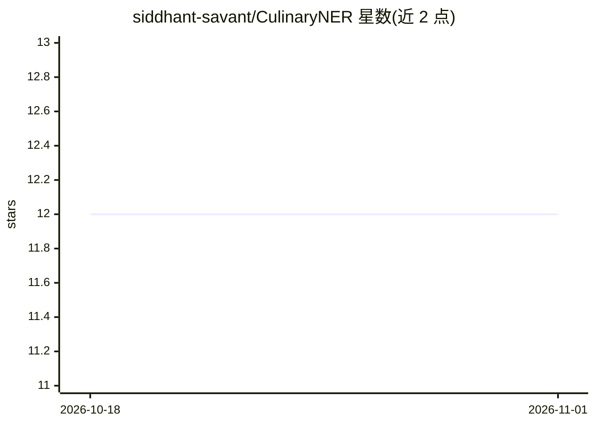

# siddhant-savant/CulinaryNER

⭐ 12 · Python · MIT · 推送 2026-02-19 · [GitHub](https://github.com/siddhant-savant/CulinaryNER) · 组织维护

**面向餐饮评论的 spaCy 命名实体识别模型，抽取菜品等 7 类实体**

基于 spaCy 训练的领域 NER 模型，从英国餐厅评论文本中抽取菜品、食材、烹饪技法、风味、口感、菜系与主厨姓名 7 类实体。训练数据为 8,000+ 条人工标注的英国餐厅评论（约 560 小时标注），基线模型整体 F1 为 0.711，按 MIT 许可开源；作者另维护一个不在此发布中的商用 BERT 模型（F1 0.758）。安装方式为 pip 安装 spaCy 后克隆仓库使用，并附训练脚本可自行训练（需 Label Studio JSON 格式数据）。

## 筛选速览

| 维度 | 判定 | 备注 |
|---|---|---|
| AI 角色 | `ai-native` | 本体是模型或模型工具 |
| 许可风险 | `permissive` | MIT |
| 部署形态 | `library` | 以包/库形式分发 |
| 模型依赖 | — | README 未给出锁定关系 |
| 硬件要求 | — | 无带数字的原话,不猜 |
| 安装摩擦 | `low` | 无编译、无系统依赖或容器化 |
| 成熟度 | — | 结构信号不足 |

## 能力要点

- 7 类实体：Dish/Ingredient/Technique/Flavor/Texture/Cuisine/Chef Name
- 8,000+ 条人工标注英国餐厅评论训练，基线 F1 0.711
- 提供训练脚本，支持用自有标注数据再训练
- 聚焦英国餐饮语境（如 pudding、chips 等 UK 用语）

## 适用场景

- 从餐厅评论中提取菜品与食材做菜单分析
- 追踪评论中主厨提及以构建声誉系统
- 按风味/口感组合做菜品趋势研究

## 场景标签

`数据分析` · 领域:效率与自动化

## 证据(README 行号)

> L9: A trained spaCy model for extracting dishes, ingredients, cooking techniques, flavors, and more from restaurant revi
> L16: - **7 entity types**: Dish, Ingredient, Technique, Flavor, Texture, Cuisine, Chef Name

## 星数曲线

2026-10-18 12 → 2026-11-01 12（+0）

---
*卡片 v1 · prompt 1.4 · 生成 2026-11-01 · 置信度 mid · 依据 README sha `c9d9ae553639` · [字段定义](../../DATASET.md)*
