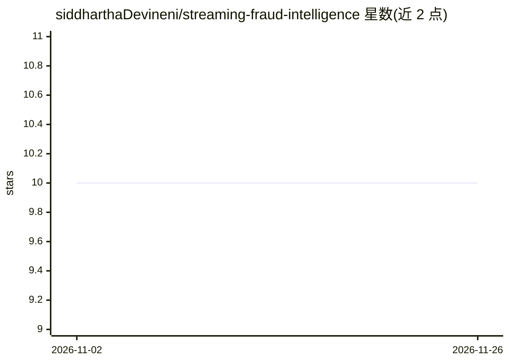

# siddharthaDevineni/streaming-fraud-intelligence

⭐ 10 · Python · MIT · 推送 2026-10-26 · [GitHub](https://github.com/siddharthaDevineni/streaming-fraud-intelligence) · 个人维护

**分布式实时欺诈检测系统：Kafka流+ML推理+LLM多代理+RAG自改进**

混合 Java/Python 微服务构成的欺诈检测流水线：Kafka Streams 做实时富集（速度窗口、客户画像 KTable 连接），XGBoost+SHAP 做可解释 ML 推理，5 个 LangChain 专业代理对每笔交易执行 10 次 LLM 调用并经共识协调器合成决策，ChromaDB 检索历史确认案例注入代理提示，River 在线学习从分析师反馈主题实时更新模型。分析师决策回流构成反馈闭环。本地经 Docker Compose 运行，或部署至 GKE（Strimzi Kafka、Secret Manager）。面向需要实时反欺诈检测的工程团队。

## 筛选速览

| 维度 | 判定 | 备注 |
|---|---|---|
| AI 角色 | `ai-native` | 本体是模型或模型工具 |
| 许可风险 | `permissive` | MIT |
| 部署形态 | `self-host` | docker 或自建部署 |
| 模型依赖 | locked-api |  |
| 硬件要求 | — | 无带数字的原话,不猜 |
| 安装摩擦 | `low` | 无编译、无系统依赖或容器化 |
| 成熟度 | — | 结构信号不足 |

## 能力要点

- 每笔交易 5 个专业代理、10 次 LLM 调用的并行+协作+共识流水线
- ChromaDB RAG 检索历史确认案例并注入链式思维指导
- River SRPClassifier 在线学习，无需重训练周期
- XGBoost+SHAP 输出 top-3 特征贡献的可解释预测

## 适用场景

- 对实时交易流做欺诈检测与风险评分
- 利用自身确认历史案例增强 LLM 代理判断
- 通过分析师反馈持续在线更新检测模型
- 在 GKE 上以云原生方式部署反欺诈流水线

## 场景标签

`多智能体` `RAG` `金融量化` · 领域:Agent 开发

## 证据(README 行号)

> L5: A distributed, cloud-native, event-driven fraud detection system — hybrid Java/Python microservices combining
> L8: LangChain multi-agent LLM analysis, River online learning, and FastAPI endpoints for both transaction analysis
> L38: 4. **LangChain Agents** `Python / Groq` — 5 specialized agents running 10 LLM calls per

## 星数曲线

2026-11-02 10 → 2026-11-26 10（+0）

---
*卡片 v1 · prompt 1.4 · 生成 2026-11-19 · 置信度 high · 依据 README sha `17f4a29bfaab` · [字段定义](../../DATASET.md)*
