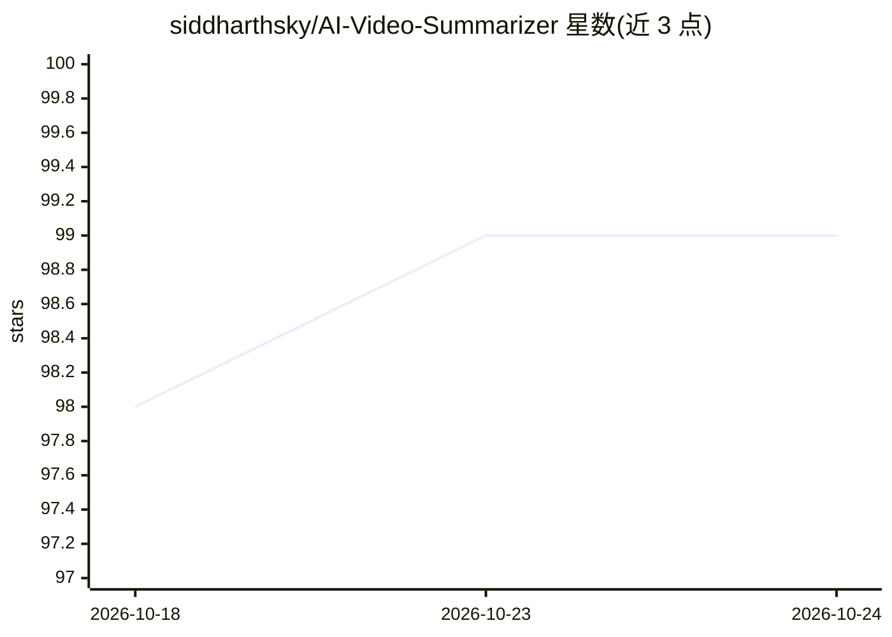

# siddharthsky/AI-Video-Summarizer

⭐ 99 · Python · MIT · 推送 2026-05-04 · [GitHub](https://github.com/siddharthsky/AI-Video-Summarizer) · 个人维护

**用 LLM 生成 YouTube 视频摘要与时间戳的 Web 应用**

基于 Streamlit 的 YouTube 视频摘要工具：通过 youtube-transcript-api 获取视频字幕/转录文本，调用 Google Gemini 或 OpenAI GPT API 生成摘要并抽取关键要点与时间戳，用户可选择后端模型。运行需 Python 3.10 与至少一个 LLM API Key（写入 .env 文件）。以源码方式提供，git clone 后 pip 安装依赖，streamlit run 启动 Web 界面。

## 筛选速览

| 维度 | 判定 | 备注 |
|---|---|---|
| AI 角色 | `ai-native` | 本体是模型或模型工具 |
| 许可风险 | `permissive` | MIT |
| 部署形态 | `library` | 以包/库形式分发 |
| 模型依赖 | — | README 未给出锁定关系 |
| 硬件要求 | — | 无带数字的原话,不猜 |
| 安装摩擦 | `low` | 无编译、无系统依赖或容器化 |
| 成熟度 | — | 结构信号不足 |

## 能力要点

- 自动从 YouTube 视频抽取关键要点与时间戳
- 支持选择 GPT 或 Gemini 作为摘要模型
- 通过 youtube-transcript-api 获取字幕/转录文本

## 适用场景

- 快速了解长视频内容以减少观看时间
- 为 YouTube 视频生成带时间戳的摘要

## 场景标签

 · 领域:视频内容理解/LLM 应用

## 证据(README 行号)

> L20: This project is an AI-powered video summarizer designed specifically for YouTube videos. Leveraging the Google Gemi
> L24: - Automatic extraction of key insights and timestamps from YouTube videos.
> L26: - Option for users to select AI models like *GPT* or *Gemini* for summarization.

## 星数曲线

2026-10-18 98 → 2026-10-24 99（+1）

---
*卡片 v1 · prompt 1.4 · 生成 2026-10-23 · 置信度 mid · 依据 README sha `06a8b01f3ab1` · [字段定义](../../DATASET.md)*
