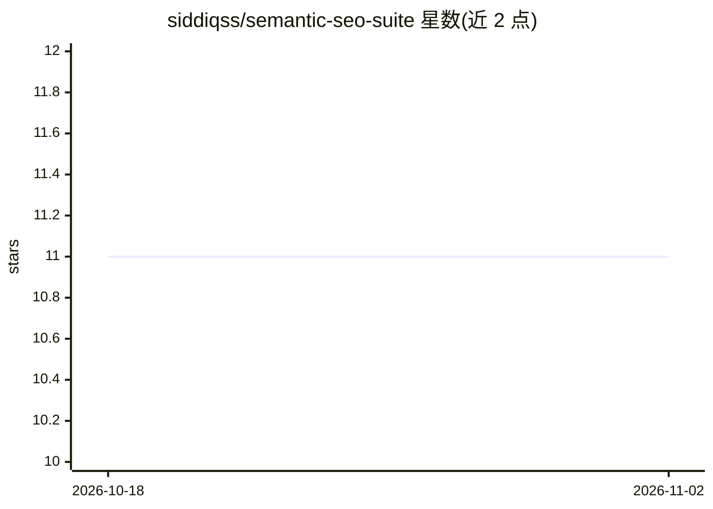

# siddiqss/semantic-seo-suite

⭐ 11 · Python · MIT · 推送 2026-07-04 · [GitHub](https://github.com/siddiqss/semantic-seo-suite) · 个人维护

**Claude Code 技能套件：做语义 SEO/GEO 内容，带防编造数字护栏**

以 10 个 Claude Code skills 形式提供的语义 SEO 工具集：从中心实体构建 pillar/cluster 主题地图与内容日历，生成实体感知的内容简报与草稿，草稿需通过三道质量门（防编造护栏、深度/质量评分、AEO 引用评分），每个数字标注 measured/derived/asserted 来源。另含站内审计（内容缺口、关键词蚕食、实体漂移）、内链与 JSON-LD schema、GEO 优化、外链拓展与分发计划。数据分三档：T0 仅需 LLM+网页搜索，T1 免费安装/GSC，T2 需 SerpApi key。产物为用户自有的 Markdown/JSON/HTML 文件，非 SaaS。也可在 Claude Desktop/web 中以插件方式安装。限制：无本地 SEO 模块、无专门多语言模式、导出无一键 Notion/Sheets。

## 筛选速览

| 维度 | 判定 | 备注 |
|---|---|---|
| AI 角色 | `ai-native` | 本体是模型或模型工具 |
| 许可风险 | `permissive` | MIT |
| 部署形态 | `library` | 以包/库形式分发 |
| 模型依赖 | locked-api |  |
| 硬件要求 | — | 无带数字的原话,不猜 |
| 安装摩擦 | `low` | 无编译、无系统依赖或容器化 |
| 成熟度 | `idea` | |

## 能力要点

- 10 个技能：主题地图、简报、草稿、审计、schema、GEO、外链、分发等
- 三道质量门：validate_draft.py 防编造护栏、draft_quality.py、aeo_score.py
- 所有输出数字标注 measured/derived/asserted 溯源
- 三级 grounding：T0 免费纯 LLM，T1 GSC，T2 SerpApi
- 产物为用户自有文件（JSON/Markdown/HTML 热力图），MIT 免费

## 适用场景

- 规划网站主题权威地图与内容日历，生成有溯源的内容草稿
- 审计现有站点的内容缺口、关键词蚕食与实体漂移
- 优化内容以被 ChatGPT/Perplexity/AI Overviews 引用（GEO）
- 在 Claude Code 或 Claude Desktop 中以自然语言执行 SEO 流程，替代付费订阅工具

## 场景标签

`AI 写作` · 领域:内容生成

## 证据(README 行号)

> L3: **A free, open-source alternative to Surfer, MarketMuse, Clearscope & Frase — built as Claude Code skills. Topical a
> L73: |**semantic-draft-writer**|Writes the draft, runs 3 gates (fabrication → quality → AEO)|
> L82: 1. **`validate_draft.py`** — fabrication guard: no naked stats, no unbacked brand claims (hard gate).

## 星数曲线

2026-10-18 11 → 2026-11-02 11（+0）

---
*卡片 v1 · prompt 1.4 · 生成 2026-11-01 · 置信度 mid · 依据 README sha `9f58f1507c43` · [字段定义](../../DATASET.md)*
