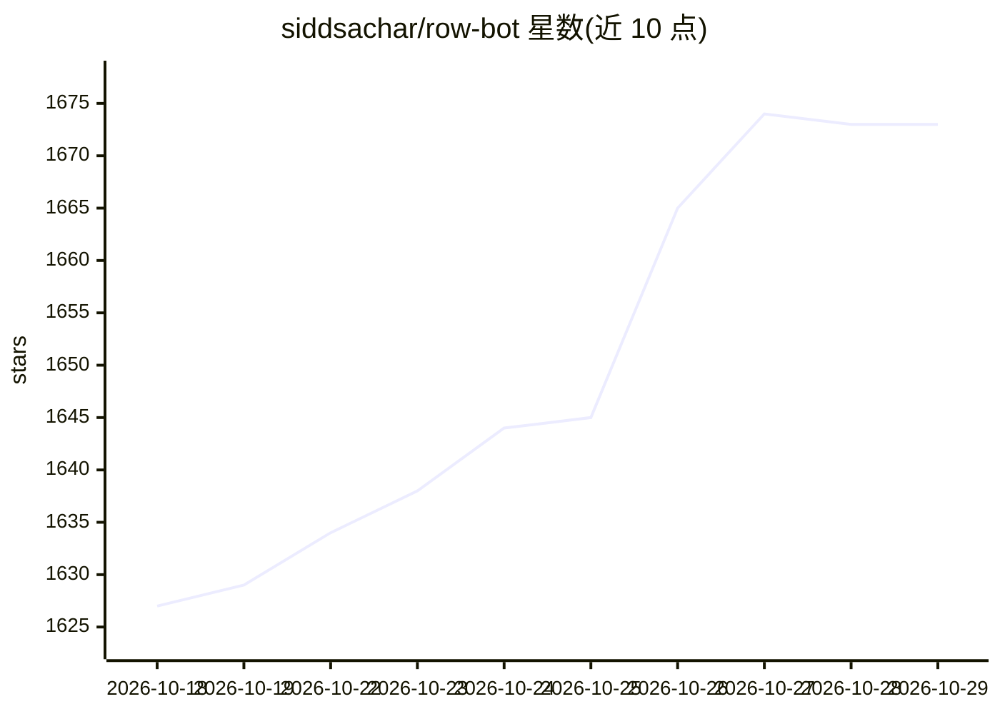

# siddsachar/row-bot

⭐ 1,673 · Python · Apache-2.0 · 推送 2026-10-28 · [GitHub](https://github.com/siddsachar/row-bot) · [官网](https://row-bot.ai) · 个人维护

**本地优先的个人 AI 助手：对话驱动工具、记忆与多端访问**

单用户多设备的桌面/服务器 AI 助手：以对话方式处理设计稿、代码、文档与工作流，将重要信息存入本地知识图谱（含 Dream Cycle 整理与 Obsidian 兼容 vault），危险操作需 Approve/Deny 确认。模型可经 Ollama 本地运行，或接入 ChatGPT/Claude/Grok 订阅、API key 及 OpenAI 兼容端点。提供 Windows/macOS/Linux 安装包与 Docker 镜像，支持 Telegram/WhatsApp 等渠道及语音。无账号系统与托管推理，数据留在本机。

## 筛选速览

| 维度 | 判定 | 备注 |
|---|---|---|
| AI 角色 | `ai-native` | 本体是模型或模型工具 |
| 许可风险 | `permissive` | Apache-2.0 |
| 部署形态 | `self-host` | docker 或自建部署 |
| 模型依赖 | local-ok | 支持本地模型 |
| 硬件要求 | — | 无带数字的原话,不猜 |
| 安装摩擦 | `low` | 无编译、无系统依赖或容器化 |
| 成熟度 | `idea` | |

## 能力要点

- 本地知识图谱记忆与 Obsidian 兼容 vault
- 经 Ollama 本地运行模型，或接入 ChatGPT/Claude/Grok 订阅与 OpenAI 兼容端点
- 风险操作需 Approve/Deny 审批，支持目标持续执行的委派 agent
- Telegram/WhatsApp/Discord/Slack/SMS 渠道与本地 Whisper/SenseVoice 语音

## 适用场景

- 在本地运行一个能读写文件、执行 shell 与浏览器自动化的个人 AI 助手
- 用个人知识图谱与提醒管理日常事务（如生日、待办）
- 通过 QR 码从手机或其他电脑远程访问同一实例
- 以定时/ webhook 工作流自动执行任务并推送到聊天渠道

## 场景标签

`AI 助手` `知识图谱` `浏览器自动化` `工作流自动化` · 领域:效率与自动化

## 证据(README 行号)

> L12: Row-Bot is a local-first desktop AI assistant for doing real work with models,
> L16: risky. It runs local models through Ollama, provider API
> L25: - **Conversations that do the work** - ask for a deck, an app or a report and

## 星数曲线

2026-10-18 1,627 → 2026-10-29 1,673（+46）

---
*卡片 v1 · prompt 1.4 · 生成 2026-10-21 · 置信度 mid · 依据 README sha `89b724df83d3` · [字段定义](../../DATASET.md)*
