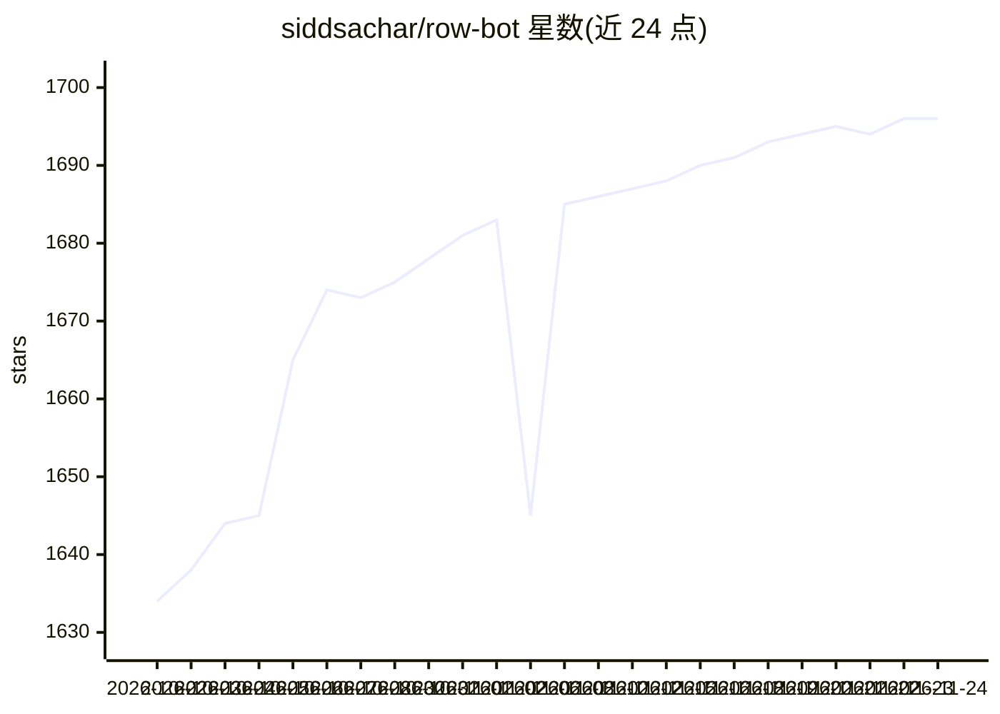

# siddsachar/row-bot

⭐ 1,696 · Python · Apache-2.0 · 推送 2026-11-22 · [GitHub](https://github.com/siddsachar/row-bot) · [官网](https://row-bot.ai) · 个人维护

**本地优先的桌面 AI 助手：记忆、代理工作流与工具执行**

面向个人用户的本地优先桌面 AI 助手，以对话方式执行任务：本地知识图谱记忆、目标与委派 agent、工作流（定时/webhook/链式）、风险操作审批机制、设计文档与代码面板、可连接 GitHub/Notion 等服务。模型来源可选本机模型服务器（Ollama/LM Studio/vLLM/llama.cpp）、ChatGPT/Claude/Grok 订阅、API key 或 OpenRouter 免费模型。单属主多设备架构，非多用户托管。提供 Windows/macOS 安装包、Linux 安装脚本、Docker 镜像与 Railway 托管路径。

## 筛选速览

| 维度 | 判定 | 备注 |
|---|---|---|
| AI 角色 | `ai-native` | 本体是模型或模型工具 |
| 许可风险 | `permissive` | Apache-2.0 |
| 部署形态 | `self-host` | docker 或自建部署 |
| 模型依赖 | local-ok | 支持本地模型 |
| 硬件要求 | — | 无带数字的原话,不猜 |
| 安装摩擦 | `low` | 无编译、无系统依赖或容器化 |
| 成熟度 | — | 结构信号不足 |

## 能力要点

- 本地知识图谱记忆，含记忆审阅、合并与 Obsidian 兼容 vault
- 风险操作需 Approve/Deny 审批，Activity log 记录全部动作
- 本地 Whisper/SenseVoice/Kokoro 语音听写与朗读
- 桌面安装包、浏览器、Docker 与 Railway 多种运行形态

## 适用场景

- 让助手在本机文件与代码库里持续完成指定任务
- 将 ChatGPT 等助手的记忆迁移到本地私有助手
- 通过 Telegram/WhatsApp 等渠道与个人助手交互
- 在手机上审批助手发起的风险操作

## 场景标签

`AI 助手` `工作流自动化` `知识图谱` `Agent 记忆` · 领域:Agent 开发

## 证据(README 行号)

> L12: Row-Bot is a local-first desktop AI assistant for doing real work with models,
> L189: 1. On first launch Row-Bot asks **How should Row-Bot think?**: on this

## 星数曲线

2026-10-22 1,634 → 2026-11-24 1,696（+62）

---
*卡片 v1 · prompt 1.4 · 生成 2026-11-23 · 置信度 mid · 依据 README sha `8a83686942a4` · [字段定义](../../DATASET.md)*
