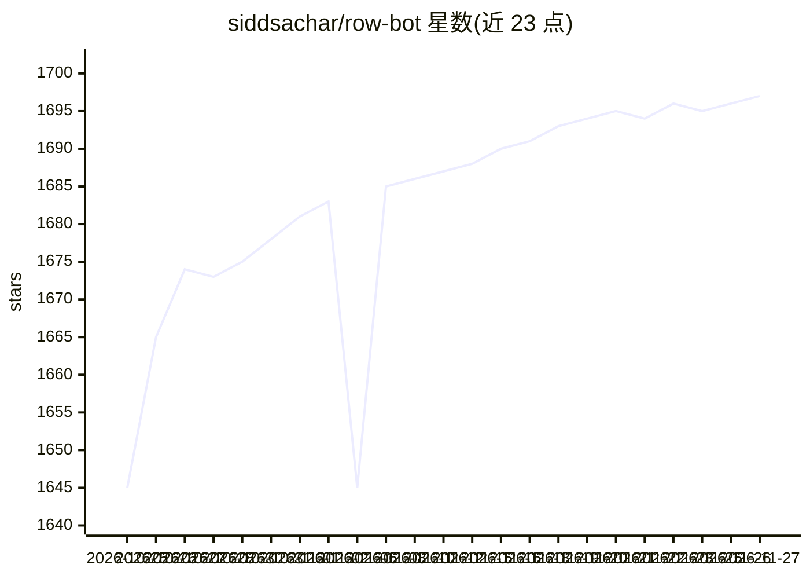

# siddsachar/row-bot

⭐ 1,697 · Python · Apache-2.0 · 推送 2026-11-26 · [GitHub](https://github.com/siddsachar/row-bot) · [官网](https://row-bot.ai) · 个人维护

**本地优先的桌面 AI 助手：记忆、工具、代理与工作流**

面向个人用户的本地优先桌面 AI 助手：对话中可生成设计文件、代码文件夹、报告等产出，本地知识图谱存储记忆，支持目标追踪、受委托代理、工作流（定时/webhook/链式）与风险操作的审批机制。模型思考层可选用 ChatGPT/Claude/Grok 订阅、API key、OpenRouter 免费模型或本地模型服务器；数据保留在本机，单所有者多设备使用。提供 Windows/macOS 安装包、Linux 脚本、Docker 与 Railway 托管路径。

## 筛选速览

| 维度 | 判定 | 备注 |
|---|---|---|
| AI 角色 | `ai-native` | 本体是模型或模型工具 |
| 许可风险 | `permissive` | Apache-2.0 |
| 部署形态 | `self-host` | docker 或自建部署 |
| 模型依赖 | local-ok | 支持本地模型 |
| 硬件要求 | — | 无带数字的原话,不猜 |
| 安装摩擦 | `low` | 无编译、无系统依赖或容器化 |
| 成熟度 | — | 结构信号不足 |

## 能力要点

- 本地知识图谱记忆，支持导入 ChatGPT/Claude/Gemini 的既有记忆并有审查与撤销
- 风险操作需 Approve/Deny 审批，Activity log 记录每次操作
- 连接 GitHub、Notion、Linear、Stripe 等应用，支持自定义工具与技能录制
- 语音输入输出（Whisper/Kokoro 或云端语音）及 Telegram/WhatsApp/Discord/Slack/SMS 通道

## 适用场景

- 在本地隐私可控的环境下让 AI 助手处理文件、代码与设计任务
- 设置定时或 webhook 工作流并接收通知提醒
- 通过手机或远程设备访问同一助手实例
- 用本地模型（Ollama 等）替代云服务运行助手

## 场景标签

`AI 助手` `工作流自动化` · 领域:效率与自动化

## 证据(README 行号)

> L12: Row-Bot is a local-first desktop AI assistant for doing real work with models,
> L17: ChatGPT, Claude or Grok plan, a provider API key, OpenRouter's free models, or
> L191: 1. On first launch Row-Bot asks **How should Row-Bot think?**: on this

## 星数曲线

2026-10-25 1,645 → 2026-11-27 1,697（+52）

---
*卡片 v1 · prompt 1.4 · 生成 2026-11-24 · 置信度 mid · 依据 README sha `a4ebce5ce039` · [字段定义](../../DATASET.md)*
