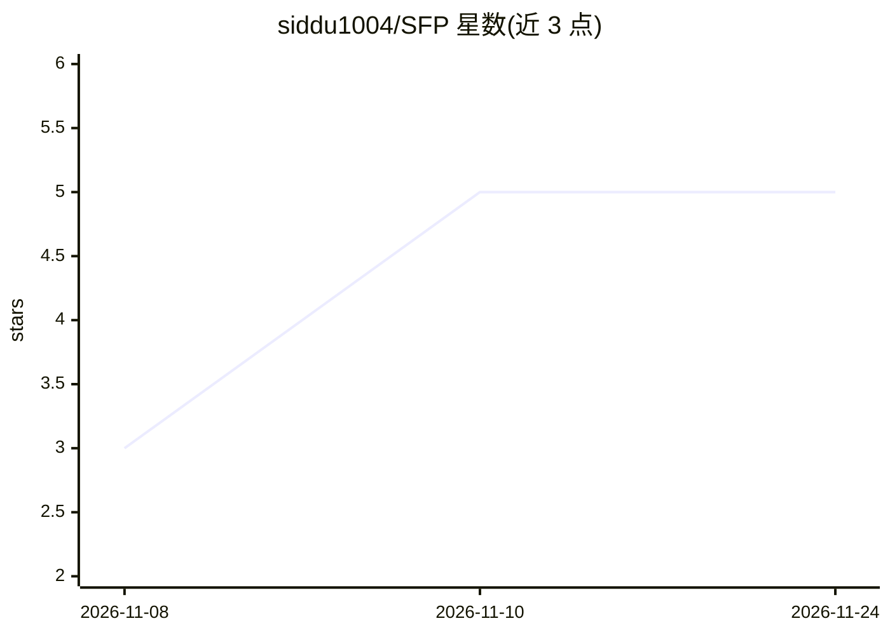

# siddu1004/SFP

⭐ 5 · Python · MIT · 推送 2026-11-09 · [GitHub](https://github.com/siddu1004/SFP) · [官网](https://www.npmjs.com/package/sfp-hive) · 个人维护

**为 AI 编码工具按需选取技能的本地路由器，节省上下文**

SFP 是面向 AI 编码工具的技能选择器：内置 1,065 个 SKILL.md 技能、24 个类别与 121 个 bundle，读取任务描述与项目 manifest（package.json、Cargo.toml 等）后，在本地选出 1-3 个匹配技能注入 Claude Code、Cursor 等 20 种工具。默认纯 Python 词汇匹配约 3ms 出结果；可选接入本地 Ollama/LM Studio 的 bge-m3 语义模型与 LLM 重排。记录 helped/unhelpful 反馈训练本地 LinUCB 模型，并可从 OpenAlex/arXiv 论文起草新技能供人工批准。需要 Node.js 与 Python 3.8+，MIT 许可。

## 筛选速览

| 维度 | 判定 | 备注 |
|---|---|---|
| AI 角色 | `ai-ecosystem` | LLM/agent 周边工具 |
| 许可风险 | `permissive` | MIT |
| 部署形态 | `desktop` | 安装包/桌面程序 |
| 模型依赖 | local-ok | 支持本地模型 |
| 硬件要求 | — | 无带数字的原话,不猜 |
| 安装摩擦 | `low` | 无编译、无系统依赖或容器化 |
| 成熟度 | — | 结构信号不足 |

## 能力要点

- 本地任务-项目匹配，约 3ms 选出 1-3 个技能，不发送数据
- 读取 package.json/Cargo.toml 等 manifests 做技术栈隔离
- 反馈驱动的 LinUCB 口味模型与 OpenAlex/arXiv 论文起草技能的 mentor
- 通过 npx 一次安装同步到 20 种 AI 编码工具，支持 MCP

## 适用场景

- 让 Claude Code/Cursor 只加载当前任务需要的技能指南
- Rust/Python/Go 等多语言项目避免装错技术栈的规则
- 根据个人偏好让 AI 给出动画/代码/文字等不同形式的教学技能

## 场景标签

`提示工程` · 领域:Agent 开发

## 证据(README 行号)

> L28: **SFP is a librarian for your AI.** It curates 1065 skills across 24 categories and **121 bundles** (every skill be
> L68:  Deterministic selection runs in ~3 ms using standard-library Python. Optional semantic search (`bge-m3`) and LLM r
> L70:  Install once and keep skills, MCP tools, and `.agents/rules/sfp-active-skills.md` synchronized across Claude Code,

## 星数曲线

2026-11-08 3 → 2026-11-24 5（+2）

---
*卡片 v1 · prompt 1.4 · 生成 2026-11-21 · 置信度 high · 依据 README sha `819f07c2eff0` · [字段定义](../../DATASET.md)*
