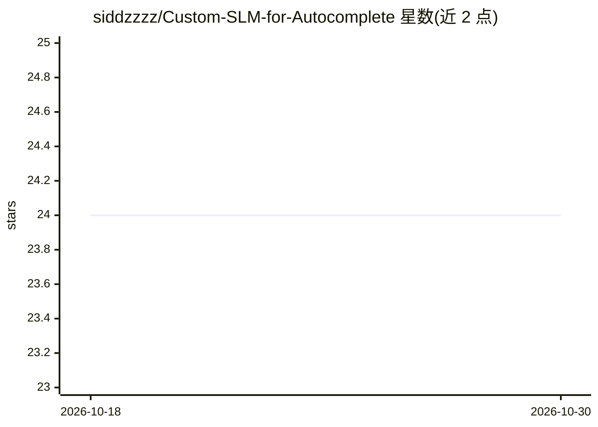

# siddzzzz/Custom-SLM-for-Autocomplete

⭐ 24 · Python · MIT · 推送 2026-05-18 · [GitHub](https://github.com/siddzzzz/Custom-SLM-for-Autocomplete) · 个人维护

**从零实现的小型语言模型，用于句子自动补全**

Velocitext 是用 PyTorch 从零实现的 GPT 风格 Transformer decoder 小型语言模型（约 25M 参数，8 层、8 头、256 token 上下文），面向消费级硬件（4GB VRAM）训练与推理。数据管道抓取 Wikipedia 并用 GPT-2 BPE tokenizer 分词；训练使用混合精度（AMP）与梯度累积，支持断点续训。提供 Web UI 实时补全建议与命令行文本生成两种使用方式。

## 筛选速览

| 维度 | 判定 | 备注 |
|---|---|---|
| AI 角色 | `ai-native` | 本体是模型或模型工具 |
| 许可风险 | `permissive` | MIT |
| 部署形态 | `library` | 以包/库形式分发 |
| 模型依赖 | — | README 未给出锁定关系 |
| 硬件要求 | `gpu-8g` | |
| 安装摩擦 | `low` | 无编译、无系统依赖或容器化 |
| 成熟度 | — | 结构信号不足 |

## 能力要点

- 从零实现的 GPT 风格 Transformer decoder，约 25M 参数
- AMP + 梯度累积，4GB VRAM 内完成训练
- Wikipedia 抓取 + GPT-2 BPE 分词的数据管道
- Web UI 实时补全与 CLI 生成，训练可断点续训

## 适用场景

- 在低显存消费级显卡上训练自己的小语言模型
- 获得实时的句子自动补全建议（Web UI）
- 学习从零搭建 Transformer decoder 的训练与推理代码

## 场景标签

`模型训练` · 领域:训练与推理

## 证据(README 行号)

> L3: Velocitext is a Small Language Model (SLM) designed for text autocomplete tasks, built from scratch using PyTorch. I
> L6: - **Custom Transformer Decoder**: Implemented from scratch (GPT-style).

## 星数曲线

2026-10-18 24 → 2026-10-30 24（+0）

---
*卡片 v1 · prompt 1.4 · 生成 2026-10-27 · 置信度 mid · 依据 README sha `fd8b42dc076f` · [字段定义](../../DATASET.md)*
