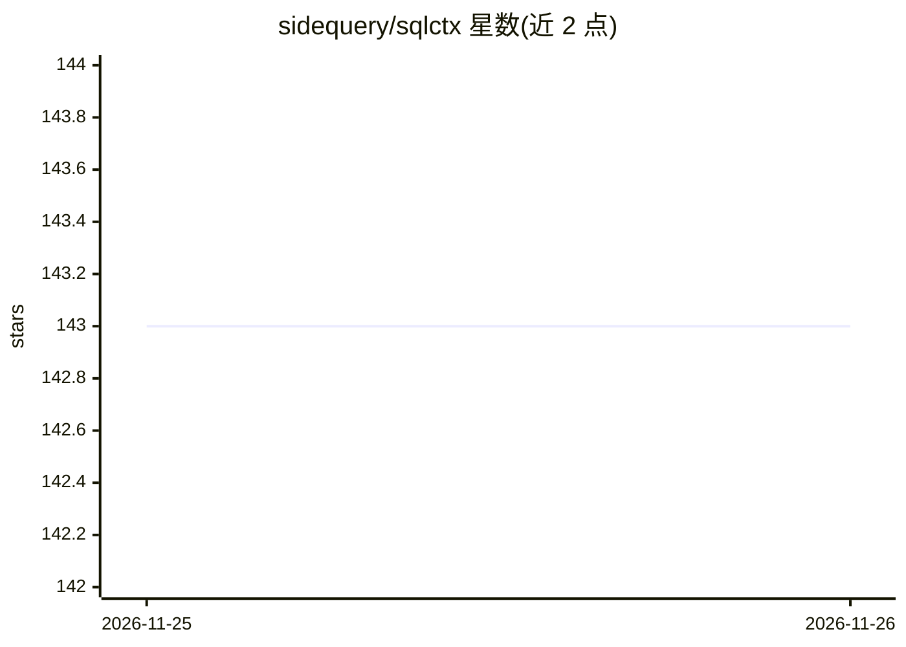

# sidequery/sqlctx

⭐ 143 · Python · AGPL-3.0 · 推送 2026-11-25 · [GitHub](https://github.com/sidequery/sqlctx) · [官网](https://sidemantic.com) · 组织维护

**开源语义层运行时：一次定义指标，多端一致查询**

sqlctx 定位为语义运行时，将指标定义一次后供 SQL、CLI、Python、HTTP、PostgreSQL 协议、notebook、BI 工具与 AI agents 查询。支持导入 Power BI TMDL/DAX、Cube、dbt MetricFlow、LookML、Hex、Rill、Superset 等 15+ 既有语义模型格式，也可用 YAML、语义 SQL DDL 或 Python 原生编写；运行于 DuckDB、PostgreSQL、BigQuery、Snowflake、ClickHouse、Databricks、Spark SQL 等仓库。提供 HTTP API、MCP server、PostgreSQL wire 协议服务与 Jupyter widget，默认 Python 引擎，可选 Rust 引擎需从源码构建。PyPI 上为早期同名工具，当前需从 GitHub 安装。

## 筛选速览

| 维度 | 判定 | 备注 |
|---|---|---|
| AI 角色 | `ai-enhanced` | 去掉 AI 部分产品仍成立 |
| 许可风险 | `viral` | AGPL-3.0 |
| 部署形态 | `self-host` | docker 或自建部署 |
| 模型依赖 | locked-api |  |
| 硬件要求 | — | 无带数字的原话,不猜 |
| 安装摩擦 | `low` | 无编译、无系统依赖或容器化 |
| 成熟度 | — | 结构信号不足 |

## 能力要点

- 自动检测并导入 15+ 种语义模型格式（Cube、MetricFlow、LookML、Power BI TMDL 等）
- 通过 PostgreSQL wire 协议、HTTP API（JSON/Arrow IPC）、MCP 等多接口对外提供服务
- 内省数据自动生成含维度、指标、关系的模型，并支持 golden-query 测试与 live 校验
- 可选 Rust 引擎与 SQLGlot 编译加速路径

## 适用场景

- 把散落在 Cube/LookML/dbt 等工具里的指标定义统一到一层
- 让 BI 工具（Tableau、DBeaver）通过 PostgreSQL 协议直接查询治理后的指标
- 为 AI agents 提供 MCP 接口查询语义化指标
- 从 CSV/Parquet/DuckDB 数据快速初始化语义模型项目

## 场景标签

`数据分析` · 领域:效率与自动化

## 证据(README 行号)

> L3: sqlctx is an open-source semantic runtime. Define governed metrics once—or import the semantic models you already ha
> L8: - **Consume metrics anywhere:** semantic SQL, CLI, Python, HTTP/Arrow, PostgreSQL wire protocol, MCP, notebooks, Typ
> L38: uvx --from "sqlctx[api,mcp] @ git+https://github.com/sidequery/sqlctx" sqlctx serve   # web UI + HTTP API + MCP on 

## 星数曲线

2026-11-25 143 → 2026-11-26 143（+0）

---
*卡片 v1 · prompt 1.4 · 生成 2026-11-24 · 置信度 high · 依据 README sha `1ba8688554e6` · [字段定义](../../DATASET.md)*
