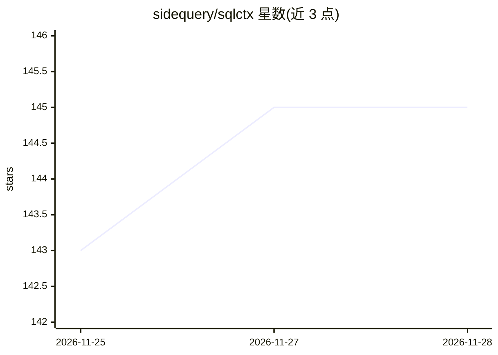

# sidequery/sqlctx

⭐ 145 · Python · AGPL-3.0 · 推送 2026-11-26 · [GitHub](https://github.com/sidequery/sqlctx) · [官网](https://sidemantic.com) · 组织维护

**语义层运行时：让 SQL/BI/AI agent 统一查询治理指标**

开源语义运行时，支持一次定义治理指标，或导入已有的语义模型（兼容 Power BI TMDL/DAX、Cube、dbt MetricFlow、LookML、Hex、Rill、Superset、Omni、BSL、Malloy 等 15+ 格式），在 DuckDB、PostgreSQL、BigQuery、Snowflake、ClickHouse 等数仓上运行。提供 CLI、Python API、HTTP API、PostgreSQL wire protocol、MCP 服务器等多种消费接口，并附带 Claude Code 与 Codex 的插件包（modeler、webapp-builder 两个技能）。

## 筛选速览

| 维度 | 判定 | 备注 |
|---|---|---|
| AI 角色 | `ai-ecosystem` | LLM/agent 周边工具 |
| 许可风险 | `viral` | AGPL-3.0 |
| 部署形态 | `self-host` | docker 或自建部署 |
| 模型依赖 | — | README 未给出锁定关系 |
| 硬件要求 | — | 无带数字的原话,不猜 |
| 安装摩擦 | `low` | 无编译、无系统依赖或容器化 |
| 成熟度 | — | 结构信号不足 |

## 能力要点

- 兼容 15+ 语义模型格式的自动检测与转换
- 支持多种消费接口：语义 SQL、CLI、Python、HTTP/Arrow、PostgreSQL 协议、MCP
- 附带 Claude Code 与 Codex 插件元数据（modeler 与 webapp-builder 技能）
- 支持 uvx 一条命令生成演示项目并运行首个查询

## 适用场景

- 把散落在 Cube/LookML/dbt MetricFlow 等工具中的指标模型导入统一运行时
- 让 BI 工具通过 PostgreSQL 协议连接治理后的指标
- 通过 MCP 让 AI agent 查询企业指标
- 从 CSV/Parquet 数据反向生成语义模型

## 场景标签

`数据分析` · 领域:效率与自动化

## 证据(README 行号)

> L3: sqlctx is an open-source semantic runtime. Define governed metrics once—or import the semantic models you already ha
> L14: sqlctx ships Claude Code and Codex plugin metadata for two skills (`modeler` and `webapp-builder`). See Agent Plugi
> L340: sqlctx ships a plugin bundle with Claude Code and Codex metadata for two skills:

## 星数曲线

2026-11-25 143 → 2026-11-28 145（+2）

---
*卡片 v1 · prompt 1.4 · 生成 2026-11-27 · 置信度 high · 依据 README sha `70f6cca75951` · [字段定义](../../DATASET.md)*
