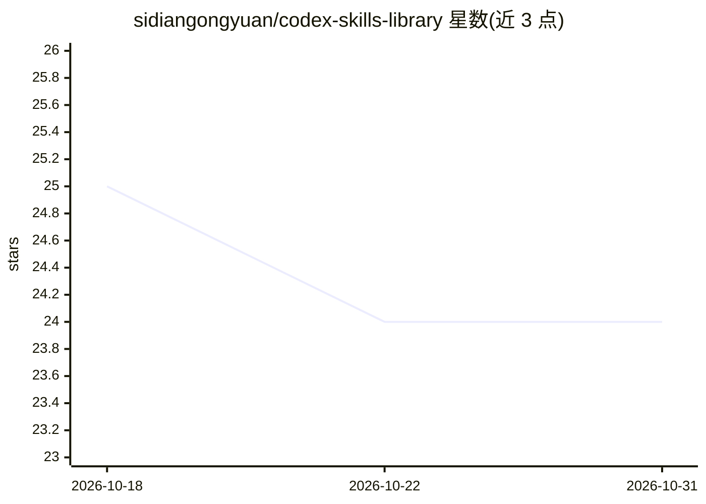

# sidiangongyuan/codex-skills-library

⭐ 24 · Python · MIT · 推送 2026-09-21 · [GitHub](https://github.com/sidiangongyuan/codex-skills-library) · 个人维护 · 中文 README

**18 个可安装的 Codex 工作流技能库：科研写作与开发运维**

面向 Codex 用户的工作流技能集合，收录 18 个可安装技能（轻量 SOP 形式，规定检查点、产出物与人工决策停点），覆盖科研论文（9 个：实验规划、证据检索、写作、评审、rebuttal、图表、报告）、应用开发（5 个）、通用方法（2 个）与 GitHub/Codex 运维（2 个）。特色技能 feishu-paper-reading 走完检索、验证、阅读、综合并发布带读回校验的飞书报告。单个技能经 Codex 的 $skill-installer 按 GitHub URL 安装，或用仓库自带 Python 脚本批量安装至 ~/.agents/skills，脚本仅依赖 Python 标准库。声明为独立社区项目，与 OpenAI 无关联。

## 筛选速览

| 维度 | 判定 | 备注 |
|---|---|---|
| AI 角色 | `ai-knowledge` | 知识聚合/清单类 |
| 许可风险 | `permissive` | MIT |
| 部署形态 | `None` |  |
| 模型依赖 | — | README 未给出锁定关系 |
| 硬件要求 | — | 无带数字的原话,不猜 |
| 安装摩擦 | `low` | 无编译、无系统依赖或容器化 |
| 成熟度 | — | 结构信号不足 |

## 能力要点

- 18 个可安装技能按科研论文/应用开发/通用方法/运维四类组织
- 技能为 SOP 形式：定义检查点、产出物与人工决策停点
- feishu-paper-reading：检索到发布飞书报告的全链路含读回校验
- 安装脚本无标准库以外的运行时依赖

## 适用场景

- 让 Codex 按固定流程规划深度学习实验或写论文
- 投稿前用 paper-review-panel 做独立评审风险检查
- 从症状与日志做应用故障根因定位
- 按目标在目录中挑选并组合多个技能完成长项目

## 场景标签

`科研工具` `提示工程` · 领域:Agent 开发

## 证据(README 行号)

> L17: Codex Skills Library collects 18 installable workflows distilled from repeated
> L18: research, software, and technical operations work. A skill is closer to a
> L19: lightweight SOP than a prompt: it tells Codex what to inspect, which checkpoints

## 星数曲线

2026-10-18 25 → 2026-10-31 24（-1）

---
*卡片 v1 · prompt 1.4 · 生成 2026-10-27 · 置信度 high · 依据 README sha `1000dfc41fe6` · [字段定义](../../DATASET.md)*
