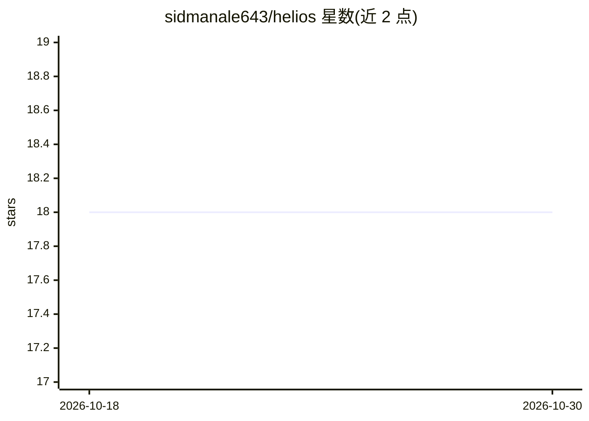

# sidmanale643/helios

⭐ 18 · Python · Apache-2.0 · 推送 2026-10-24 · [GitHub](https://github.com/sidmanale643/helios) · 个人维护

**给学习者的 PyTorch 推理引擎：本地 GPU 上运行 Qwen3-4B**

用纯 PyTorch 实现 Qwen3-4B 的模型加载、分词、KV 缓存、生成与 HTTP 服务路径，面向推理工程学习场景而非生产部署。核心机制：基于 varlen_attn 的原生 paged attention（256-token 页）、连续批调度（打包 prefill 与 decode）、持久化前缀缓存、GPU 显存准入控制、可选 n-gram 投机解码；提供 OpenAI 兼容的非流式 chat completions 端点。限制：仅支持 Qwen3-4B 一种架构、仅 NVIDIA CUDA（Ampere SM80+），不支持流式、工具调用与认证。

## 筛选速览

| 维度 | 判定 | 备注 |
|---|---|---|
| AI 角色 | `ai-ecosystem` | LLM/agent 周边工具 |
| 许可风险 | `permissive` | Apache-2.0 |
| 部署形态 | `None` |  |
| 模型依赖 | — | README 未给出锁定关系 |
| 硬件要求 | — | 无带数字的原话,不猜 |
| 安装摩擦 | `medium` | 含编译或系统依赖之一 |
| 成熟度 | `idea` | |

## 能力要点

- 原生 PyTorch paged attention（varlen_attn，256-token 共享 KV 页池）
- 连续批调度：单次打包前向同时处理 decode 与 prefill
- 持久化前缀缓存与 GPU 显存准入预算控制
- 可选 n-gram 投机解码（免草稿模型，单次目标前向验证）

## 适用场景

- 学习推理引擎内部机制（paged attention、连续批调度、前缀缓存）
- 在本地 NVIDIA GPU 上以 OpenAI 兼容 API 运行 Qwen3-4B
- 做并发请求的推理基准测试（自带含分段计时的 HTTP 基准）

## 场景标签

`推理引擎` · 领域:训练与推理

## 证据(README 行号)

> L3: Helios is a small, readable inference engine for running
> L22: - Continuous batching of concurrent requests
> L27: - A non-streaming OpenAI-style chat completions endpoint

## 星数曲线

2026-10-18 18 → 2026-10-30 18（+0）

---
*卡片 v1 · prompt 1.4 · 生成 2026-10-29 · 置信度 high · 依据 README sha `43583abd844f` · [字段定义](../../DATASET.md)*
