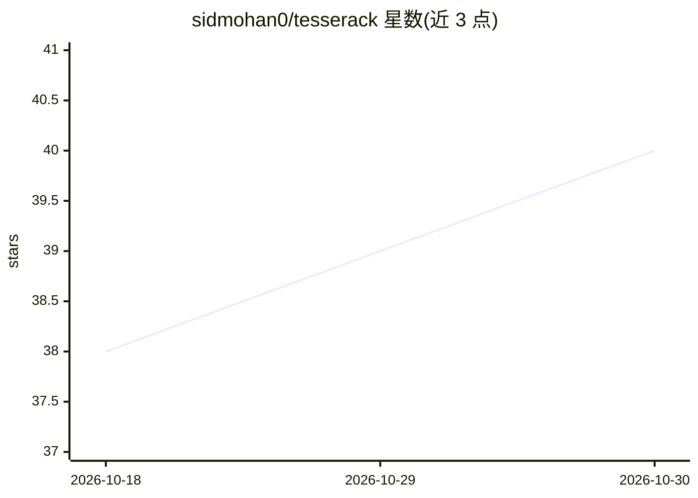

# sidmohan0/tesserack

⭐ 40 · JavaScript · 推送 2026-01-30 · [GitHub](https://github.com/sidmohan0/tesserack) · [官网](https://tesserack.ai) · 个人维护

**用 LLM 从游戏攻略编译 RL 奖励函数，训练游戏智能体**

面向强化学习研究/实验者的 Web 应用：用 Claude Vision 读取 Pokemon Prima 攻略 PDF，抽取地点、目标与坐标，编译成 675 条分层单元测试（移动/地标/目标三级），作为密集奖励信号训练 REINFORCE 策略网络，全程在浏览器内运行。纯 RL 模式运行时无需 LLM；LLM 模式使用浏览器内语言模型做任务分解。附 41 个地点的预编译测试与实时训练指标可视化，需自备 Pokemon Red ROM。

## 筛选速览

| 维度 | 判定 | 备注 |
|---|---|---|
| AI 角色 | `ai-native` | 本体是模型或模型工具 |
| 许可风险 | `none` | — |
| 部署形态 | `library` | 以包/库形式分发 |
| 模型依赖 | — | README 未给出锁定关系 |
| 硬件要求 | — | 无带数字的原话,不猜 |
| 安装摩擦 | `low` | 无编译、无系统依赖或容器化 |
| 成熟度 | — | 结构信号不足 |

## 能力要点

- Claude Vision 从攻略 PDF 抽取结构化单元测试作为密集奖励
- 三级奖励分层（0.1-0.2 微移动 / 2.0-5.0 地标 / 10.0-50.0 目标）
- 预编译 675 条测试，覆盖 41 个地点，无需 API key 即可训练
- 训练与模拟均在浏览器内完成，实时展示奖励分解与策略熵

## 适用场景

- 研究如何把人类攻略知识转化为可解释的密集奖励
- 在浏览器里训练 Pokemon Red 的 RL 智能体
- 复现或改造攻略→测试→奖励的抽取流水线

## 场景标签

`强化学习` · 领域:训练与推理

## 证据(README 行号)

> L9: Most RL game agents learn from scratch with sparse rewards ("you won" / "you lost"). Tesserack takes a different app
> L20: (Prima Guide PDF)      (Claude Vision)   (test-bundles.json)   (REINFORCE)
> L23: 1. **Extract**: Claude Vision reads pages from the Prima Strategy Guide and extracts locations, objectives, and map

## 星数曲线

2026-10-18 38 → 2026-10-30 40（+2）

---
*卡片 v1 · prompt 1.4 · 生成 2026-10-25 · 置信度 high · 依据 README sha `52c552ad8c1f` · [字段定义](../../DATASET.md)*
