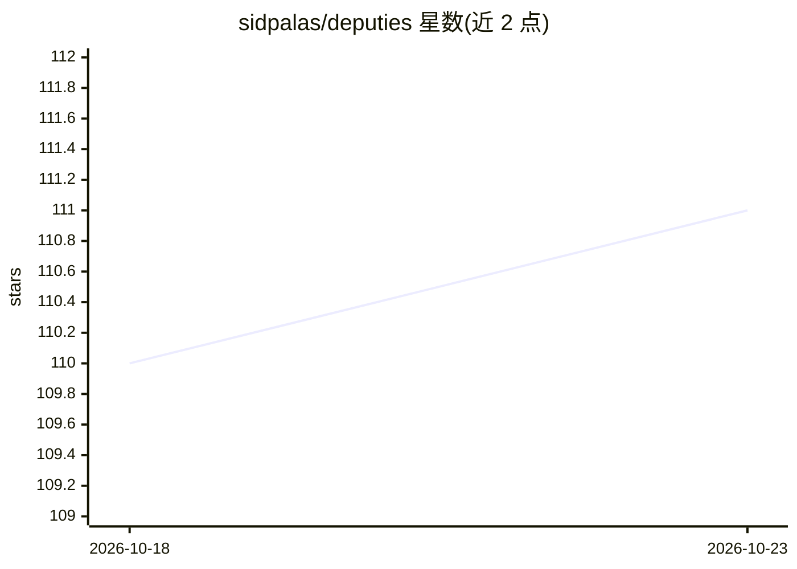

# sidpalas/deputies

⭐ 111 · TypeScript · MIT · 推送 2026-08-04 · [GitHub](https://github.com/sidpalas/deputies) · [官网](https://deputies.dev) · 个人维护

**委派工程任务给后台 Agent 的控制平面，带 Web UI**

面向开发者的 agent 控制平面：为每个任务提供持久会话，支持排队提示词、实时查看进度与工具诊断、审查产物、管理 Slack/GitHub/Webhook 回调。底层基于 Pi 执行 agent 工作，提供 fake runner 用于确定性冒烟测试；支持多种沙箱提供方（Daytona、Docker、Kubernetes Agent Sandbox、AWS Lambda MicroVM 等）与 GitHub OAuth/静态登录及多角色权限。以 Node、Caddy、Postgres 与可选 S3 兼容存储的服务组合部署，提供 Railway 模板、Docker Compose、Kubernetes Helm 与 AWS Terraform 参考部署。README 声明项目处于早期阶段，可能有不定期破坏性变更。

## 筛选速览

| 维度 | 判定 | 备注 |
|---|---|---|
| AI 角色 | `ai-ecosystem` | LLM/agent 周边工具 |
| 许可风险 | `permissive` | MIT |
| 部署形态 | `self-host` | docker 或自建部署 |
| 模型依赖 | — | README 未给出锁定关系 |
| 硬件要求 | — | 无带数字的原话,不猜 |
| 安装摩擦 | `low` | 无编译、无系统依赖或容器化 |
| 成熟度 | `idea` | |

## 能力要点

- 持久后台会话承载 agent 工作，含可搜索分页活动历史
- Slack、GitHub、通用 Webhook 集成与回调投递跟踪
- Daytona/Docker/Kubernetes/AWS Lambda MicroVM 等多种沙箱提供方
- Railway/Docker Compose/Helm/Terraform 多种部署目标

## 适用场景

- 把工程任务委派给后台 agent 并在 Web UI 跟踪进度与产物
- 团队通过权限控制共享管理 agent 会话与定时自动化
- 为 agent 沙箱工作流搭建可自托管的基础设施

## 场景标签

`Agent 框架` · 领域:Agent 开发

## 证据(README 行号)

> L3: Deputies is a control plane for delegating engineering work to background agents. It includes a fully featured web U
> L15: - Built on Pi for real agent work, with a fake runner for deterministic smoke tests.

## 星数曲线

2026-10-18 110 → 2026-10-23 111（+1）

---
*卡片 v1 · prompt 1.4 · 生成 2026-10-23 · 置信度 high · 依据 README sha `b0d0686106f7` · [字段定义](../../DATASET.md)*
