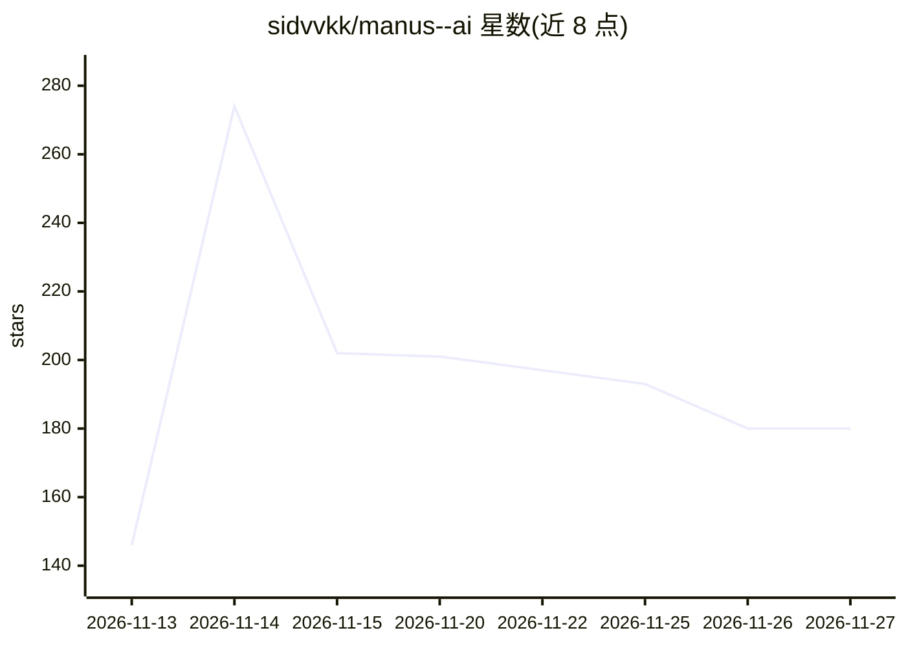

# sidvvkk/manus--ai

⭐ 180 · Apache-2.0 · 推送 2026-11-14 · [GitHub](https://github.com/sidvvkk/manus--ai) · 个人维护

**自主执行代码与控制浏览器的通用 AI Agent 助手**

面向家庭、学习与轻量办公场景的自主 AI Agent：用户以自然语言下达指令，Agent 自行编写并执行脚本、打开网页、与页面元素交互、完成多步骤任务，可在后台持续待命并跨会话复用工作流模式。README 描述其为非企业级、非重型工作室的轻量助手，覆盖研究整理、信息收集、快速脚本实验与远程排障支持等用途。未给出具体的模型接入方式、源码结构或安装命令，仅提供入门步骤与硬件兼容表。

## 筛选速览

| 维度 | 判定 | 备注 |
|---|---|---|
| AI 角色 | `ai-native` | 本体是模型或模型工具 |
| 许可风险 | `permissive` | Apache-2.0 |
| 部署形态 | `None` |  |
| 模型依赖 | — | README 未给出锁定关系 |
| 硬件要求 | — | 无带数字的原话,不猜 |
| 安装摩擦 | `low` | 无编译、无系统依赖或容器化 |
| 成熟度 | — | 结构信号不足 |

## 能力要点

- 自主编写并执行代码完成任务
- 浏览器控制：导航网页、填写表单、收集信息
- 代码与浏览器操作可在同一工作流内衔接
- 面向小规模场景的后台个人助手形态

## 适用场景

- 让 Agent 代为完成查网页、填表单等重复性操作
- 学习研究中收集资料、运行小脚本、整理笔记
- 轻量办公中汇总多页信息、准备小型报告摘要

## 场景标签

`AI 助手` `浏览器自动化` `编码 Agent` · 领域:效率与自动化

## 证据(README 行号)

> L10: - **Autonomous Code Execution:** Manus AI agent runs code on its own to complete tasks, so you can focus on decisio
> L18: Manus is an autonomous AI agent designed to run code and control a browser on your behalf. Instead of acting like a

## 星数曲线

2026-11-13 146 → 2026-11-27 180（+34）

---
*卡片 v1 · prompt 1.4 · 生成 2026-11-17 · 置信度 mid · 依据 README sha `4347b4dd3fa7` · [字段定义](../../DATASET.md)*
