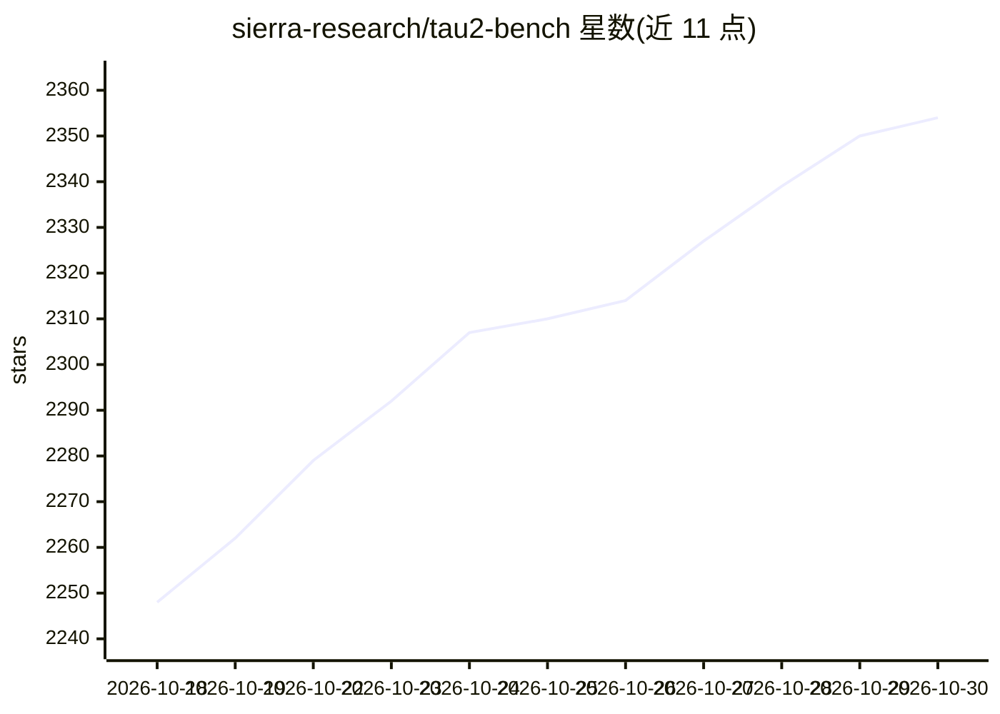

# sierra-research/tau2-bench

⭐ 2,354 · Python · MIT · 推送 2026-10-29 · [GitHub](https://github.com/sierra-research/tau2-bench) · [官网](https://www.taubench.com) · 组织维护

**评测客服 Agent 的基准框架：工具-代理-用户交互模拟与打分**

由 Sierra Research 维护的对话代理评测基准：在 airline、retail、telecom、banking_knowledge 等领域模拟用户与客服代理的多轮交互，按领域策略、可用工具与任务集对代理行为打分。支持文本半双工与语音全双lex（OpenAI/Gemini/xAI 实时 API）两种模式，提供可配置 RAG 检索的知识领域、Gymnasium RL 接口与 taubench.com 排行榜。通过 git clone + uv 安装，Python >=3.12，经 LiteLLM 接入任意模型提供方。

## 筛选速览

| 维度 | 判定 | 备注 |
|---|---|---|
| AI 角色 | `ai-ecosystem` | LLM/agent 周边工具 |
| 许可风险 | `permissive` | MIT |
| 部署形态 | `library` | 以包/库形式分发 |
| 模型依赖 | — | README 未给出锁定关系 |
| 硬件要求 | — | 无带数字的原话,不猜 |
| 安装摩擦 | `medium` | 含编译或系统依赖之一 |
| 成熟度 | — | 结构信号不足 |

## 能力要点

- 文本半双工与语音全双工（实时音频 API）两种评测模式
- 多领域（airline/retail/telecom/banking_knowledge）任务与策略定义
- banking_knowledge 域支持可配置 RAG 检索管线
- Gymnasium 兼容 RL 接口与结果浏览/重评分 CLI

## 适用场景

- 评测自家客服代理在真实领域策略下的任务完成率
- 将评测结果提交 taubench.com 排行榜对比
- 用 RL 接口在任务环境上训练代理

## 场景标签

`模型评测` · 领域:评测与运维

## 证据(README 行号)

> L37: $\tau$-bench is a simulation framework for evaluating customer service agents across multiple domains. It supports 
> L39: Each domain specifies:

## 星数曲线

2026-10-18 2,248 → 2026-10-30 2,354（+106）

---
*卡片 v1 · prompt 1.4 · 生成 2026-10-21 · 置信度 mid · 依据 README sha `24e53379e2bb` · [字段定义](../../DATASET.md)*
