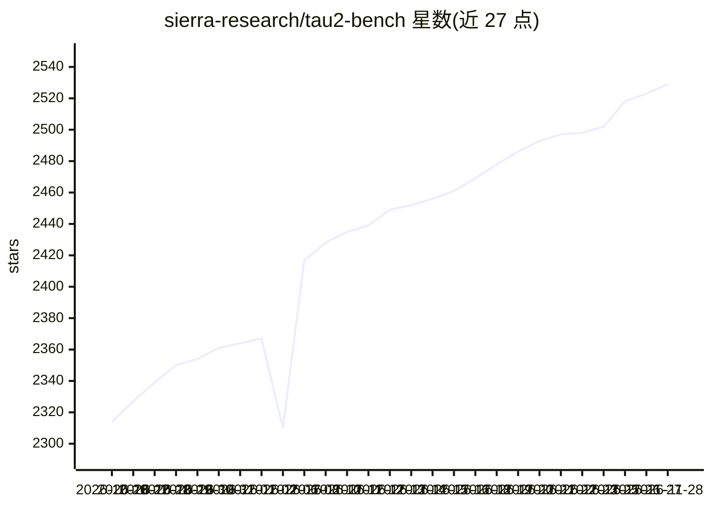

# sierra-research/tau2-bench

⭐ 2,529 · Python · MIT · 推送 2026-11-21 · [GitHub](https://github.com/sierra-research/tau2-bench) · [官网](https://www.taubench.com) · 组织维护

**客服 Agent 工具调用能力的多域评测基准框架**

面向客服场景的 Agent 评测模拟框架：每个领域提供策略、工具集、任务集与用户模拟器，支持文本半双工与语音全双工两种模式，领域包括 airline、retail、telecom、banking_knowledge、intake 等。2.0 版新增六语言包（τ-i18n）、全双工语音评测、实体捕获领域与运行后 judge 评分，冻结任务集保证可复现比较，并接入 taubench.com 排行榜提交。安装使用 uv，Python 要求 >=3.12,<3.14；2.0 与 1.x 分数不可比。

## 筛选速览

| 维度 | 判定 | 备注 |
|---|---|---|
| AI 角色 | `ai-ecosystem` | LLM/agent 周边工具 |
| 许可风险 | `permissive` | MIT |
| 部署形态 | `library` | 以包/库形式分发 |
| 模型依赖 | — | README 未给出锁定关系 |
| 硬件要求 | — | 无带数字的原话,不猜 |
| 安装摩擦 | `medium` | 含编译或系统依赖之一 |
| 成熟度 | — | 结构信号不足 |

## 能力要点

- 文本半双工与语音全双工两种评测模式
- 六个语言包：英/西/葡/印地/中/韩，含任务与数据库本地化
- 提供 Gymnasium 兼容的 RL 训练接口（--extra gym）
- 冻结任务集与 judge 评分支持结果提交与比较

## 适用场景

- 评测自研客服 Agent 在多领域任务上的表现
- 构建和评估自己的 Agent（Agent Developer Guide）
- 用 Gym 接口对 Agent 做强化学习训练
- 向 taubench.com 排行榜提交文本或语音评测结果

## 场景标签

`模型评测` `强化学习` · 领域:评测与运维

## 证据(README 行号)

> L124: $\tau$-bench is a simulation framework for evaluating customer service agents across multiple domains. It supports
> L132: **Available domains**: `mock` · `airline` · `retail` · `telecom` · `banking_knowledge` · `intake`

## 星数曲线

2026-10-26 2,314 → 2026-11-28 2,529（+215）

---
*卡片 v1 · prompt 1.4 · 生成 2026-11-23 · 置信度 mid · 依据 README sha `43c44c12027b` · [字段定义](../../DATASET.md)*
