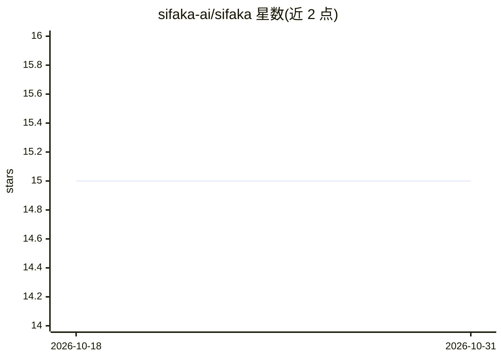

# sifaka-ai/sifaka

⭐ 15 · Python · MIT · 推送 2025-12-04 · [GitHub](https://github.com/sifaka-ai/sifaka) · [官网](https://sifaka.readthedocs.io/en/latest/) · 组织维护

**为开发者提供的 LLM 文本批判-改进框架，含完整审计链**

Python 框架，在 LLM 生成文本之上实现多轮批判与迭代改进：内置 8 种来自同行评审论文的 critic（Self-Refine、Reflexion、Constitutional AI、Self-RAG 等），配合验证器（长度、内容）做质量控制，并输出完整改进审计链。提供商无关，支持 OpenAI、Anthropic、Google、Groq 及任意 OpenAI 兼容 API，可按环境变量自动检测。提供 File/Redis 存储后端、异步与同步 API。自述为 alpha 软件（v0.3.0），适合评估与实验而非稳定生产。

## 筛选速览

| 维度 | 判定 | 备注 |
|---|---|---|
| AI 角色 | `ai-ecosystem` | LLM/agent 周边工具 |
| 许可风险 | `permissive` | MIT |
| 部署形态 | `None` |  |
| 模型依赖 | locked-api |  |
| 硬件要求 | — | 无带数字的原话,不猜 |
| 安装摩擦 | `low` | 无编译、无系统依赖或容器化 |
| 成熟度 | `idea` | |

## 能力要点

- 8 种基于同行评审论文的 critic（Self-Refine/Reflexion/Constitutional/Self-RAG 等）
- 完整审计链记录每一步文本改进
- 提供商无关：OpenAI/Anthropic/Google/Groq 及 OpenAI 兼容 API
- File 与 Redis 存储后端，全异步并兼容 FastAPI/Django 等框架

## 适用场景

- 我对 AI 生成的文案做多轮自动批判与改进
- 我需要为 LLM 输出改进过程留下可审计记录
- 我要按长度、关键词、语气等标准验证生成文本质量

## 场景标签

`AI 写作` · 领域:内容生成

## 证据(README 行号)

> L3: AI text improvement through research-backed critique with complete observability
> L17: - **Research-Backed Improvement**: Implements peer-reviewed critique techniques (Reflexion, Constitutional AI, Self
> L18: - **Complete Observability**: Full audit trail showing exactly how text improved

## 星数曲线

2026-10-18 15 → 2026-10-31 15（+0）

---
*卡片 v1 · prompt 1.4 · 生成 2026-10-30 · 置信度 high · 依据 README sha `c9df3f5aa3e7` · [字段定义](../../DATASET.md)*
