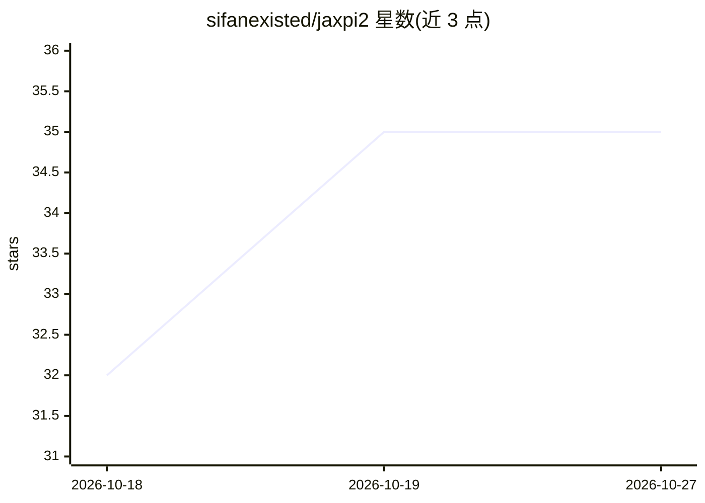

# sifanexisted/jaxpi2

⭐ 35 · Python · Apache-2.0 · 推送 2026-08-12 · [GitHub](https://github.com/sifanexisted/jaxpi2) · [官网](https://sifanexisted.github.io/jaxpi2/) · 组织维护

**JAX 实现的物理信息神经网络库：解 PDE、多 GPU 训练**

基于 JAX/Flax 的物理信息神经网络（PINN）研究库，集成多篇论文中的网络架构（PirateNet、ModifiedMlp、Fourier/周期嵌入）与训练算法（伪时间步进、因果训练、时间窗口课程、梯度对齐）。训练开箱支持单/多 GPU（jax.shard_map 数据并行），评估目前限单 GPU；附 16 个基准算例（Kolmogorov 流、Taylor-Green、Kuramoto-Sivashinsky 等），每个算例含配置、训练入口与评估 notebook。核心包小，问题物理放在 examples/。使用 Weights & Biases 记录指标，Orbax 做断点续训。要求 Python 3.11+，Linux+CUDA 13 为目标环境，也可 CPU 运行。

## 筛选速览

| 维度 | 判定 | 备注 |
|---|---|---|
| AI 角色 | `ai-native` | 本体是模型或模型工具 |
| 许可风险 | `permissive` | Apache-2.0 |
| 部署形态 | `library` | 以包/库形式分发 |
| 模型依赖 | — | README 未给出锁定关系 |
| 硬件要求 | `cpu-ok` | |
| 安装摩擦 | `medium` | 含编译或系统依赖之一 |
| 成熟度 | — | 结构信号不足 |

## 能力要点

- 集成 10 篇论文的 PINN 架构与训练算法
- 数据并行多 GPU 训练（jax.shard_map），评估限单 GPU
- 16 个 PDE 基准算例含配置与评估 notebook
- Orbax checkpoint 断点续训，时间窗算例从最后窗口恢复

## 适用场景

- 研究者在多 GPU 上训练 PINN 求解 PDE
- 复现 PINN 训练算法论文（因果训练、伪时间步进等）
- 对比不同网络架构在流体/反应扩散基准上的表现

## 场景标签

`科研工具` · 领域:学习与行业

## 证据(README 行号)

> L13: This repository is a comprehensive implementation of physics-informed neural networks (PINNs),
> L29: and robustness of our implementation. Training supports both **single** and **multi-GPU** setups out of

## 星数曲线

2026-10-18 32 → 2026-10-27 35（+3）

---
*卡片 v1 · prompt 1.4 · 生成 2026-10-25 · 置信度 mid · 依据 README sha `8a00e5544fe6` · [字段定义](../../DATASET.md)*
