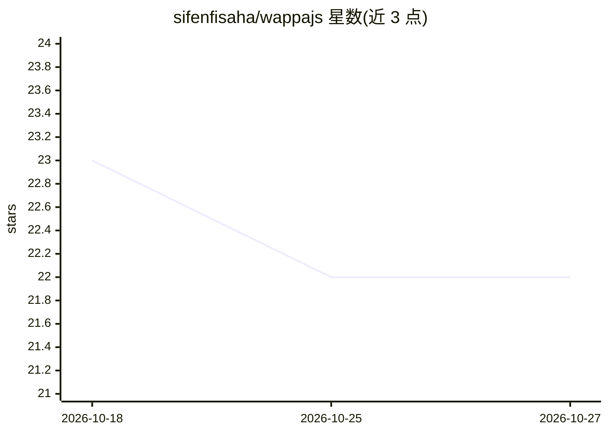

# sifenfisaha/wappajs

⭐ 22 · TypeScript · MIT · 推送 2026-09-22 · [GitHub](https://github.com/sifenfisaha/wappajs) · [官网](https://wappajs.seefun.dev) · 个人维护

**构建 WhatsApp LLM Agent 的 TypeScript 框架**

TypeScript 框架，用于开发以 LLM 为大脑、以 WhatsApp 传输层为身体的 agent：定义指令、工具与 provider，选择 Baileys（个人号 QR 登录）、官方 Cloud API 或 Twilio 传输层即可运行。核心包不依赖任何 WhatsApp 库，通过适配器对接；工具用 zod 定义并校验参数；内置会话、中间件、人工接管与离线测试工具。Anthropic 提供商支持提示缓存与 thinking 块回放。注意 Baileys 为非官方客户端，可能违反 WhatsApp 服务条款导致封号。

## 筛选速览

| 维度 | 判定 | 备注 |
|---|---|---|
| AI 角色 | `ai-ecosystem` | LLM/agent 周边工具 |
| 许可风险 | `permissive` | MIT |
| 部署形态 | `library` | 以包/库形式分发 |
| 模型依赖 | local-ok | 支持本地模型 |
| 硬件要求 | — | 无带数字的原话,不猜 |
| 安装摩擦 | `low` | 无编译、无系统依赖或容器化 |
| 成熟度 | — | 结构信号不足 |

## 能力要点

- 传输层无关核心，支持 Baileys / Cloud API / Twilio 三种适配器
- Provider 无关的 agent 循环：Anthropic、OpenAI 及任意 OpenAI 兼容服务器
- zod 类型化工具定义，参数校验失败转为可重试结果
- 内置 MockTransport + ScriptedProvider 可离线单元测试整个 bot

## 适用场景

- 构建接入 LLM 的 WhatsApp 客服或业务机器人
- 在 OpenAI 兼容服务器（如 Ollama）上跑 WhatsApp agent
- 离线单元测试整个 bot 而无需 WhatsApp 账号和 LLM key

## 场景标签

`Agent 框架` · 领域:Agent 开发

## 证据(README 行号)

> L9: `wappa` is a TypeScript framework for building WhatsApp agents: bots whose "brain" is an
> L22: - **Provider-agnostic agent loop.** The core owns the tool-call loop and conversation

## 星数曲线

2026-10-18 23 → 2026-10-27 22（-1）

---
*卡片 v1 · prompt 1.4 · 生成 2026-10-27 · 置信度 high · 依据 README sha `e8000cd4849a` · [字段定义](../../DATASET.md)*
