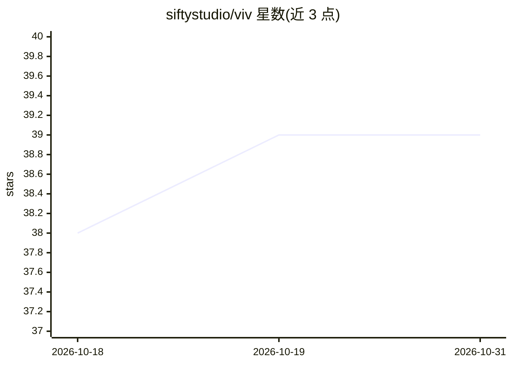

# siftystudio/viv

⭐ 39 · TypeScript · NOASSERTION · 推送 2026-09-05 · [GitHub](https://github.com/siftystudio/viv) · [官网](https://viv.sifty.studio) · 组织维护

**面向叙事设计师的涌现叙事引擎与 DSL**

游戏与模拟中的涌现叙事引擎：提供自定义编程语言（.viv DSL）描述角色行为规范，编译为 JSON 内容包后由 JavaScript/TypeScript 运行时执行动作选择、规划与故事筛取（从模拟实例中识别涌现情节）。要求 Python 3.11+（编译器）与 Node.js 18+（运行时），暂仅支持 JS 运行时，Unity/C# 运行时为规划中。可选装 Claude Code 插件进行 LLM 辅助创作；源码可见，非商业使用免费，商业使用需向 Sifty 购买许可。项目处于 open beta，各组件 0.x 版本。

## 筛选速览

| 维度 | 判定 | 备注 |
|---|---|---|
| AI 角色 | `ai-enhanced` | 去掉 AI 部分产品仍成立 |
| 许可风险 | `none` | NOASSERTION |
| 部署形态 | `library` | 以包/库形式分发 |
| 模型依赖 | — | README 未给出锁定关系 |
| 硬件要求 | — | 无带数字的原话,不猜 |
| 安装摩擦 | `low` | 无编译、无系统依赖或容器化 |
| 成熟度 | `idea` | |

## 能力要点

- .viv DSL 编译为 JSON 内容包，运行时执行动作选择与规划
- 故事筛取（story sifting）：从模拟实例中识别涌现故事线
- 提供 JetBrains/VS Code/Sublime 编辑器插件
- 可选 Claude Code 插件支持 LLM 辅助创作

## 适用场景

- 在游戏或模拟中构建自底向上涌现的叙事系统
- 从模拟运行记录中筛取并识别情节线
- 用 LLM 辅助编写 Viv 叙事内容

## 场景标签

 · 领域:游戏开发/叙事模拟

## 证据(README 行号)

> L15: In *emergent narrative*, stories arise from the bottom up, as characters take action in a simulated storyworld, rat
> L45: ### I use LLMs
> L60: ### I do not use LLMs

## 星数曲线

2026-10-18 38 → 2026-10-31 39（+1）

---
*卡片 v1 · prompt 1.4 · 生成 2026-10-25 · 置信度 high · 依据 README sha `74292eb35ab0` · [字段定义](../../DATASET.md)*
