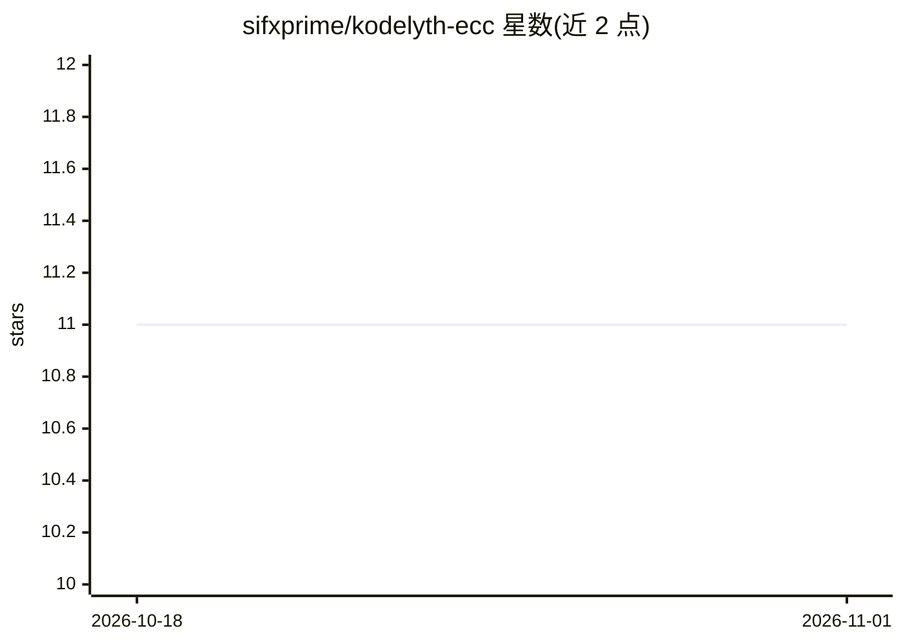

# sifxprime/kodelyth-ecc

⭐ 11 · JavaScript · MIT · 推送 2026-10-07 · [GitHub](https://github.com/sifxprime/kodelyth-ecc) · [官网](https://ecc.kodelyth.com) · 个人维护

**面向编码 AI 工具的本地 agent/技能工具包：70 个专家 agent 加意图路由**

Kodelyth ECC 是分发给多种 AI 编码工具的本地工具包：70 个专家 agent、196 个技能、103 个 slash 命令、44 个 hook，核心机制为语义意图路由（10 级优先规则把自然语言请求分派给对应专家）与本地自学习记忆（BM25 召回、跨 IDE 共享同一 JSONL 文件）。另提供 MCP 服务器（16 工具）、并行多 agent 命令、RTK 输出压缩与代码库知识图谱。支持 11 个 IDE 平台，功能深度因平台而异（hooks 为 Claude Code 原生格式，Cursor 不兼容其 agent 格式）。需 Node.js 18+，通过 npx/npm、curl 脚本或 git clone 安装，零遥测。

## 筛选速览

| 维度 | 判定 | 备注 |
|---|---|---|
| AI 角色 | `ai-ecosystem` | LLM/agent 周边工具 |
| 许可风险 | `permissive` | MIT |
| 部署形态 | `library` | 以包/库形式分发 |
| 模型依赖 | — | README 未给出锁定关系 |
| 硬件要求 | — | 无带数字的原话,不猜 |
| 安装摩擦 | `low` | 无编译、无系统依赖或容器化 |
| 成熟度 | — | 结构信号不足 |

## 能力要点

- 10 级优先规则的语义意图路由，自然语言直接分派 70 个专家 agent
- 本地 BM25 自学习记忆，同机多 IDE 共享 memories.jsonl
- MCP 服务器暴露 16 工具/6 prompts/365 资源，可接入任意 MCP 框架
- 8 个并行多 agent 命令与 44 个质量 hook

## 适用场景

- 在 Claude Code 等 11 个编码工具中用自然语言召唤对应专家 agent
- 跨 IDE 维护共享的本地项目记忆与经验沉淀
- 通过 MCP 协议把 agent/技能体系接入 LangGraph、CrewAI 等框架
- 按 indie-hacker/red-team/enterprise 预设包快速装配工作流

## 场景标签

`Agent 框架` `多智能体` `Agent 记忆` · 领域:Agent 开发

## 证据(README 行号)

> L48: **Kodelyth ECC** is a production-grade AI coding toolkit — **70 specialist agents (incl. an 8-agent devil-mode adve
> L273: Run ECC as a Model Context Protocol server and consume it from Claude Desktop, LangGraph, AutoGen, CrewAI, OpenAI 

## 星数曲线

2026-10-18 11 → 2026-11-01 11（+0）

---
*卡片 v1 · prompt 1.4 · 生成 2026-11-01 · 置信度 high · 依据 README sha `96e5435a8c6c` · [字段定义](../../DATASET.md)*
