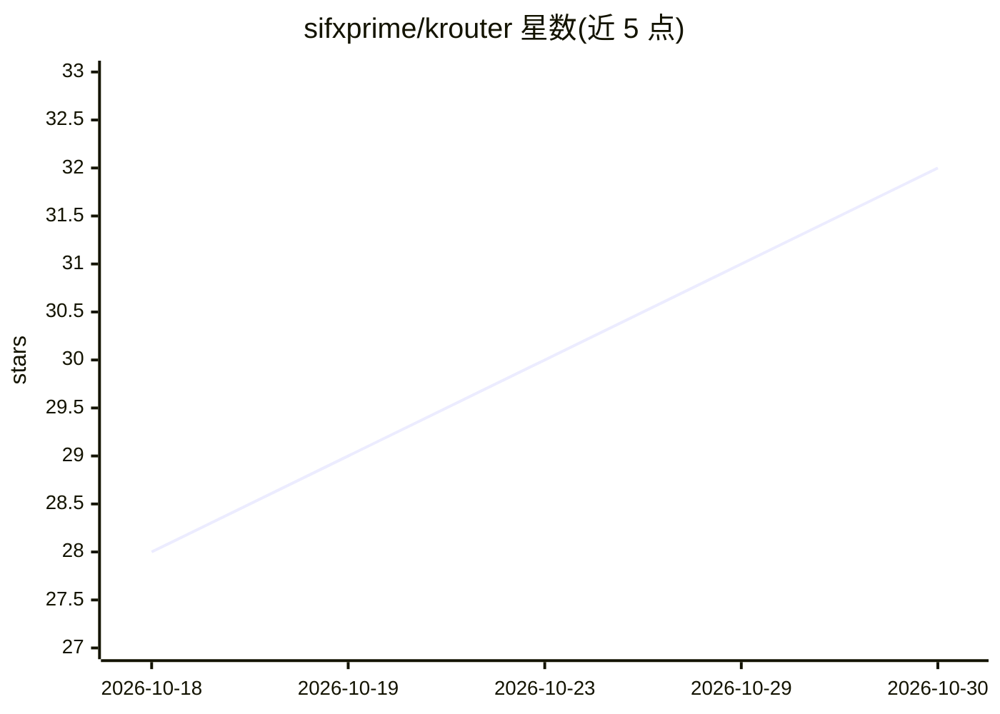

# sifxprime/krouter

⭐ 32 · JavaScript · MIT · 推送 2026-10-25 · [GitHub](https://github.com/sifxprime/krouter) · [官网](https://krouter.kodelyth.com) · 组织维护

**自托管通用 AI 路由网关：统一接入 95+ 提供商并自动故障切换**

面向使用 Claude Code、Cursor、Codex、Copilot 等编码工具的开发者的本地 API 网关：通过单一 OpenAI 兼容端点（localhost:20128/v1）路由到 95+ 提供商与 100+ 模型。机制包括 Zenith 按成功率/延迟/配额给账户评分并冷却限流账户、多账户轮换、自定义模型组合的跨提供商故障切换、RTK 压缩工具输出以节省 20-40% 输入 token、OAuth token 自动刷新、MITM 拦截接管部分 IDE 客户端流量，以及可选的 Presidio PII 脱敏 sidecar（默认关闭、故障关闭）。提供 npm、Docker、源码与 PM2 部署方式，含 Web 仪表盘。限制：部分订阅会话未经代理使用授权，仪表盘会警告账户可能受限。

## 筛选速览

| 维度 | 判定 | 备注 |
|---|---|---|
| AI 角色 | `ai-ecosystem` | LLM/agent 周边工具 |
| 许可风险 | `permissive` | MIT |
| 部署形态 | `self-host` | docker 或自建部署 |
| 模型依赖 | local-ok | 支持本地模型 |
| 硬件要求 | — | 无带数字的原话,不猜 |
| 安装摩擦 | `low` | 无编译、无系统依赖或容器化 |
| 成熟度 | — | 结构信号不足 |

## 能力要点

- Zenith 路由按成功率/延迟/剩余配额评分并冷却限流账户
- 多账户轮换与自定义组合的跨提供商自动故障切换
- RTK Token Saver 压缩工具输出，节省 20-40% 输入 token（默认开启）
- OpenAI/Claude/Gemini/Ollama 格式互译，支持任意 OpenAI 兼容客户端

## 适用场景

- 把多个 AI 编码工具统一指向一个本地端点管理
- 订阅额度用尽或限流时自动切换到备用账户/提供商
- 在提示词离开本机前剥离 PII（需自行启用 Presidio sidecar）
- 聚合多账户配额做负载均衡

## 场景标签

`模型网关` · 领域:Agent 开发

## 证据(README 行号)

> L7:  Connect Claude Code, Cursor, Antigravity, Kiro, Copilot, Codex, OpenCode, Cline, OpenClaw, and any OpenAI-compatibl
> L111: - **RTK Token Saver** — on by default; compresses tool outputs to save 20–40% of input tokens per request
> L115: - **Universal client support** — works with OpenAI, Anthropic, Responses, Gemini and Ollama-format clients

## 星数曲线

2026-10-18 28 → 2026-10-30 32（+4）

---
*卡片 v1 · prompt 1.4 · 生成 2026-10-26 · 置信度 high · 依据 README sha `ae0d9a867a57` · [字段定义](../../DATASET.md)*
