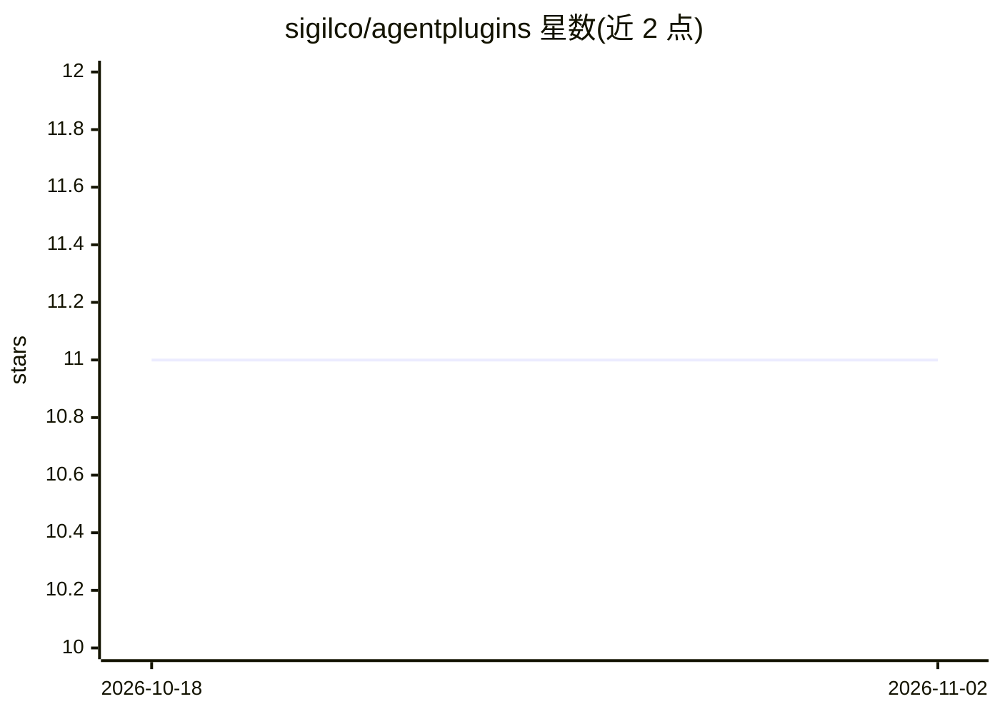

# sigilco/agentplugins

⭐ 11 · TypeScript · Apache-2.0 · 推送 2026-10-08 · [GitHub](https://github.com/sigilco/agentplugins) · [官网](https://agentplugins.pages.dev/) · 组织维护

**一次编写 AI agent 插件，编译适配多种 agent 框架的 CLI**

面向插件开发者的 CLI 工具：用单一 manifest 描述插件，经 @agentplugins/core 编译器路由到 7 个适配器，输出各 harness 的原生格式，无运行时代理层。Tier-1（Claude Code、Codex、OpenCode、Pi Mono）获得完整能力对等，Tier-2（Copilot、Gemini、Kimi）支持 skills+commands 与部分 hooks；能力缺口在编译期发出 WARN。提供脚手架初始化、构建与发布流程，安装方式含 curl 脚本与 npx。

## 筛选速览

| 维度 | 判定 | 备注 |
|---|---|---|
| AI 角色 | `ai-ecosystem` | LLM/agent 周边工具 |
| 许可风险 | `permissive` | Apache-2.0 |
| 部署形态 | `library` | 以包/库形式分发 |
| 模型依赖 | — | README 未给出锁定关系 |
| 硬件要求 | — | 无带数字的原话,不猜 |
| 安装摩擦 | `low` | 无编译、无系统依赖或容器化 |
| 成熟度 | — | 结构信号不足 |

## 能力要点

- 单一 manifest 编译到 7 个 agent harness 适配器
- Tier-1/Tier-2 分层支持，能力缺口编译期 WARN
- 适配器直接输出目标 harness 原生格式，无 shim 层
- 提供 init/build 脚手架与插件移植指南

## 适用场景

- 我写的 agent 插件想同时发布到 Claude Code、Codex 等多个框架
- 把已有插件移植到其他 agent harness
- 维护多框架插件时核对能力兼容矩阵

## 场景标签

`Agent 框架` · 领域:Agent 开发

## 证据(README 行号)

> L5:  Write AI agent plugins once, ship to any harness.
> L74: One manifest → seven adapters. Each adapter owns its output format; the `@agentplugins/core` compiler routes capabi

## 星数曲线

2026-10-18 11 → 2026-11-02 11（+0）

---
*卡片 v1 · prompt 1.4 · 生成 2026-11-01 · 置信度 high · 依据 README sha `baabac1a0505` · [字段定义](../../DATASET.md)*
