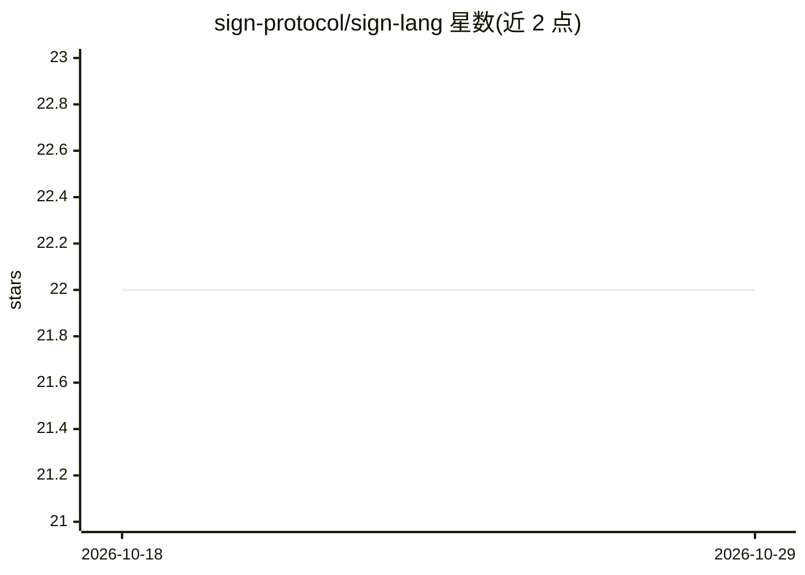

# sign-protocol/sign-lang

⭐ 22 · JavaScript · Apache-2.0 · 推送 2026-09-29 · [GitHub](https://github.com/sign-protocol/sign-lang) · [官网](https://careerhighways.com) · 组织维护

**面向 agent 的知识表示规范：强类型知识图契约层，令牌优化**

SIGN 是一个开放规范（Apache 2.0），定义供 LLM agent 消费的知识表示格式：以类 Markdown 语法表达实体结构、关系模式、推理规则、约束、聚类、溯源与治理信息，编译产出常注入系统提示的索引层（约 400 令牌）与按需检索的完整文档层，配套 CLI 编译命令与 validator 规范。README 给出与 JSON/RDF 的令牌对比数据。面向构建生产级 agent 系统的团队，起源于 Career Highways，v1.0 于 2026 年 4 月发布。

## 筛选速览

| 维度 | 判定 | 备注 |
|---|---|---|
| AI 角色 | `ai-ecosystem` | LLM/agent 周边工具 |
| 许可风险 | `permissive` | Apache-2.0 |
| 部署形态 | `None` |  |
| 模型依赖 | — | README 未给出锁定关系 |
| 硬件要求 | — | 无带数字的原话,不猜 |
| 安装摩擦 | `low` | 无编译、无系统依赖或容器化 |
| 成熟度 | — | 结构信号不足 |

## 能力要点

- 表达结构/关系/推理规则/约束/溯源/治理的知识图规范
- 两层交付：索引常注入系统提示 + get_canon_doc 按需取全文
- sign compile CLI 产出 canon-index/canon-bundle/manifest
- README 给出与 JSON 的令牌对比（全库文档 61% 缩减）

## 适用场景

- 为生产 agent 系统提供可治理、可版本化的领域知识层
- 降低注入系统提示的知识令牌开销
- 让 agent 在关系与规则层面推理而非仅检索文本

## 场景标签

`知识图谱` · 领域:知识与检索

## 证据(README 行号)

> L26: ## What SIGN Is
> L61: |**Layer 1 — Index**|Injected into every agent system prompt. ~400 tokens for a full corpus. Document identity, sta

## 星数曲线

2026-10-18 22 → 2026-10-29 22（+0）

---
*卡片 v1 · prompt 1.4 · 生成 2026-10-27 · 置信度 high · 依据 README sha `f20e256dbea1` · [字段定义](../../DATASET.md)*
