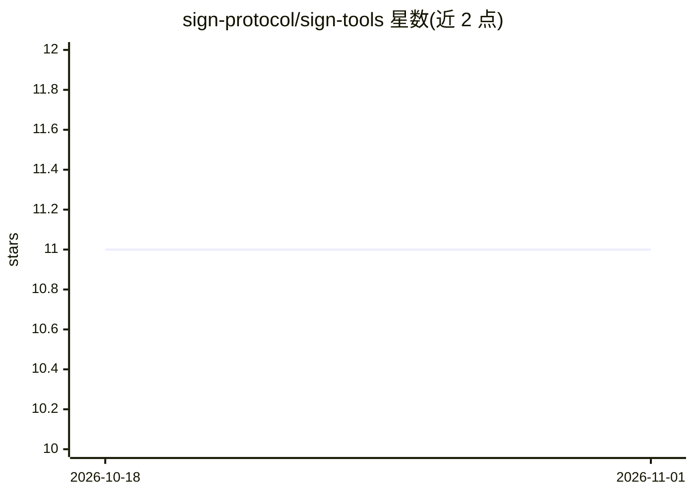

# sign-protocol/sign-tools

⭐ 11 · JavaScript · Apache-2.0 · 推送 2026-07-21 · [GitHub](https://github.com/sign-protocol/sign-tools) · [官网](https://github.com/sign-protocol/sign-lang) · 组织维护

**SIGN 标注规范工具箱：文档转 SIGN 格式与起草工具**

SIGN（Sigil Intelligence Graph Notation）开源项目的参考实现与工具集 monorepo，包含两个工具：sign-ingest（v0.1）将非结构化文档（策略、标准、ADR、计划）转换为带完整溯源与人工审查能力的 SIGN 格式；sign-draft（v0.1）是基于 Claude Code 的技能，从意图（概念、笔记、需求）生成新的 SIGN 文档。仓库采用 AI 原生开发实践，内含 .agent 代理操作系统（协调指南、策略、计划）。两工具均处于 v0.1 参考实现阶段。

## 筛选速览

| 维度 | 判定 | 备注 |
|---|---|---|
| AI 角色 | `ai-ecosystem` | LLM/agent 周边工具 |
| 许可风险 | `permissive` | Apache-2.0 |
| 部署形态 | `None` |  |
| 模型依赖 | — | README 未给出锁定关系 |
| 硬件要求 | — | 无带数字的原话,不猜 |
| 安装摩擦 | `low` | 无编译、无系统依赖或容器化 |
| 成熟度 | — | 结构信号不足 |

## 能力要点

- sign-ingest：非结构化文档转 SIGN 格式，含溯源追踪与人工审查
- sign-draft：Claude Code 技能，从意图生成新 SIGN 文档
- 仓库内建代理操作系统（.agent 目录：策略、计划、决策记录）

## 适用场景

- 将策略、标准、ADR 等文档转换为面向 agent 的 SIGN 知识声明
- 从概念或需求出发起草新的 SIGN 文档
- 为 SIGN 生态贡献新的工具或技能

## 场景标签

`知识图谱` `文档解析` · 领域:知识与检索

## 证据(README 行号)

> L5: SIGN (Sigil Intelligence Graph Notation) is a strongly-typed, human-readable, token-optimized notation system for de
> L29: Reference implementation for converting unstructured documents (policies, standards, ADRs, plans) into valid SIGN f
> L35: Claude Code skill for authoring net-new SIGN documents from intent (a concept, notes, or requirements) — the genera

## 星数曲线

2026-10-18 11 → 2026-11-01 11（+0）

---
*卡片 v1 · prompt 1.4 · 生成 2026-11-01 · 置信度 mid · 依据 README sha `a31598c50712` · [字段定义](../../DATASET.md)*
