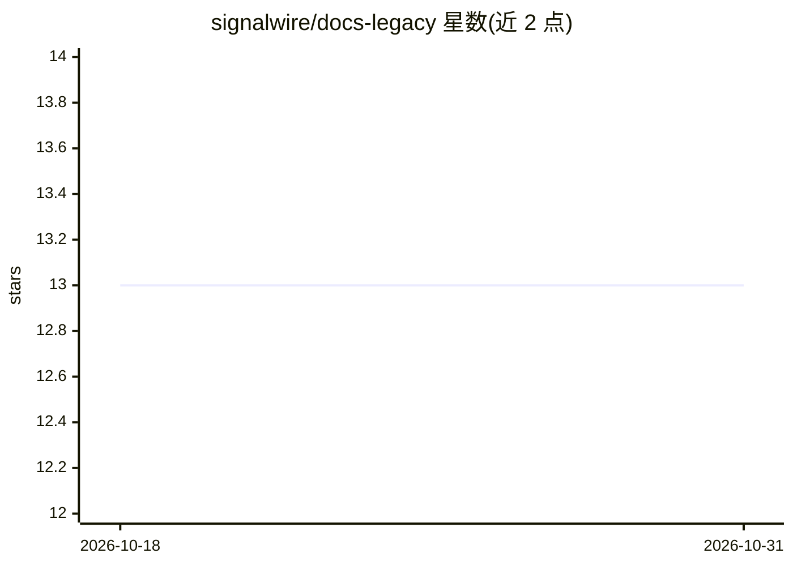

# signalwire/docs-legacy

⭐ 13 · MDX · MIT · 推送 2026-09-10 · [GitHub](https://github.com/signalwire/docs-legacy) · [官网](https://developer.signalwire.com) · 组织维护

**SignalWire 官方文档站源码仓库，基于 Docusaurus 构建**

SignalWire 通信平台（FreeSWITCH/IVR/电话相关）官方文档网站的开放源码仓库，使用 Docusaurus 构建。内容按 Guides、Technical Reference、Pages 三类组织；API 参考文档由 TypeSpec 编译为 OpenAPI 规范后自动生成。面向文档贡献者与 SignalWire 开发者，提供本地开发流程：安装 Node.js、克隆仓库、npm install 依赖、npm run start 启动本地服务器、npm run build 生成静态站点。文本内容采用 MIT 与 CC BY-NC-SA 4.0 双许可。

## 筛选速览

| 维度 | 判定 | 备注 |
|---|---|---|
| AI 角色 | `ai-knowledge` | 知识聚合/清单类 |
| 许可风险 | `permissive` | MIT |
| 部署形态 | `library` | 以包/库形式分发 |
| 模型依赖 | — | README 未给出锁定关系 |
| 硬件要求 | — | 无带数字的原话,不猜 |
| 安装摩擦 | `low` | 无编译、无系统依赖或容器化 |
| 成熟度 | — | 结构信号不足 |

## 能力要点

- 基于 Docusaurus 的开放文档站源码
- API 参考由 TypeSpec 编译为 OpenAPI 规范自动生成
- 内容分 Guides / Technical Reference / Pages 三类组织
- 提供 npm 本地开发与构建流程

## 适用场景

- 查阅或本地构建 SignalWire 平台的 API 与 SDK 文档
- 为 SignalWire 文档提交勘误或新内容
- 参考 TypeSpec/OpenAPI 自动生成文档的工程做法

## 场景标签

 · 领域:通信平台/开发者文档

## 证据(README 行号)

> L2:  An open-source docs site built with 🦕 Docusaurus
> L40: The SignalWire Docs are built with Docusaurus.

## 星数曲线

2026-10-18 13 → 2026-10-31 13（+0）

---
*卡片 v1 · prompt 1.4 · 生成 2026-10-31 · 置信度 high · 依据 README sha `fef3a5a053cf` · [字段定义](../../DATASET.md)*
