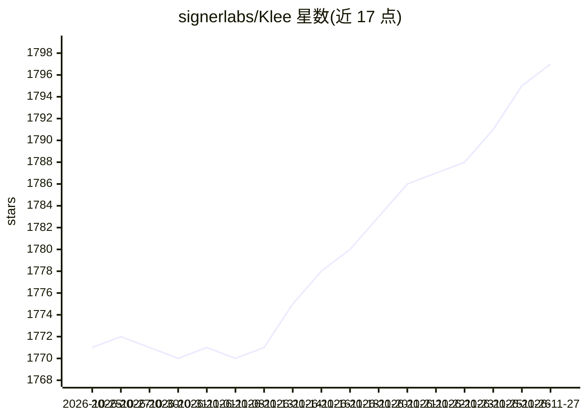

# signerlabs/Klee

⭐ 1,797 · Swift · 推送 2026-11-25 · [GitHub](https://github.com/signerlabs/Klee) · [官网](https://kleedesktop.com) · 组织维护

**Apple Silicon 上全本地推理的 macOS AI 聊天应用**

基于 MLX 在 Apple Silicon 上直接运行大语言模型的原生 macOS 应用，对话数据不离开本机，无需账号或 API key。提供一键模型下载（mlx-community 4-bit 量化）、流式响应、思考过程展示、视觉模型图片输入，并通过原生工具调用实现文件读写、网页搜索（Jina API）与 shell 命令执行。要求 macOS 15+、M1 芯片及 16 GB 起内存；分发签名的 .zip 安装包，也可用 Xcode 从源码构建。

## 筛选速览

| 维度 | 判定 | 备注 |
|---|---|---|
| AI 角色 | `ai-native` | 本体是模型或模型工具 |
| 许可风险 | `none` | — |
| 部署形态 | `desktop` | 安装包/桌面程序 |
| 模型依赖 | — | README 未给出锁定关系 |
| 硬件要求 | — | 无带数字的原话,不猜 |
| 安装摩擦 | `low` | 无编译、无系统依赖或容器化 |
| 成熟度 | — | 结构信号不足 |

## 能力要点

- 100% 本地推理，无需账号与 API key
- 一键下载 mlx-community 4-bit 量化模型，按 RAM 推荐适配模型
- 原生工具调用：文件读写、网页搜索/抓取、shell 执行（30s 超时）
- 约 60 MB 原生 SwiftUI 应用，无 Electron/Docker/后台服务

## 适用场景

- 在 Mac 上离线与本地大模型对话
- 让 AI 直接读写本地文件并执行 shell 命令
- 对数据隐私有要求、不希望对话上云的日常问答
- 按内存容量选择运行不同规模的本地模型

## 场景标签

`聊天机器人` `AI 助手` · 领域:对话与助手

## 证据(README 行号)

> L11: A native macOS AI agent that runs entirely on your Mac. No cloud, no account, no subscription.
> L13: Klee uses MLX to run large language models directly on Apple Silicon, so your conversations never leave your device
> L17: - **100% local inference** -- your data stays on your Mac

## 星数曲线

2026-10-25 1,771 → 2026-11-27 1,797（+26）

---
*卡片 v1 · prompt 1.4 · 生成 2026-11-23 · 置信度 high · 依据 README sha `17e56ae9a939` · [字段定义](../../DATASET.md)*
