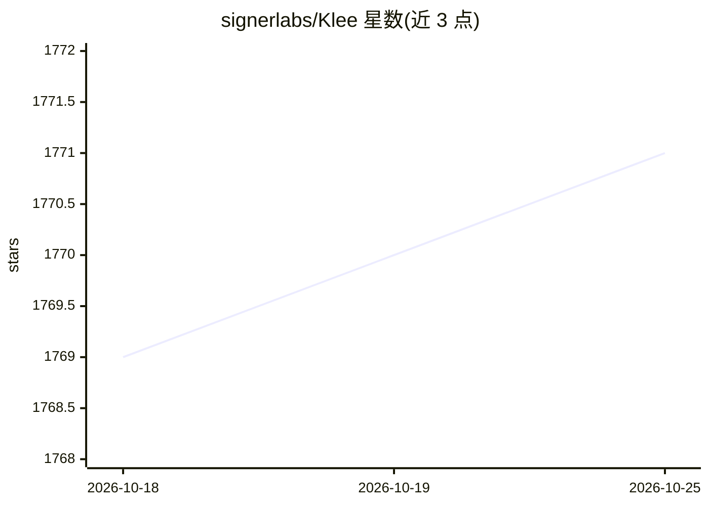

# signerlabs/Klee

⭐ 1,771 · Swift · 推送 2026-03-20 · [GitHub](https://github.com/signerlabs/Klee) · [官网](https://shipswift.app) · 组织维护

**Apple Silicon 本地运行的 macOS 原生 AI 聊天应用**

基于 MLX 在 Apple Silicon 上本地推理的原生 macOS AI agent，SwiftUI 构建，约 75MB。无需账号与 API key，支持一键下载 4-bit 量化模型（Qwen/Gemma/DeepSeek 系列，来自 mlx-community）、流式输出、推理过程展示、视觉输入与内置工具调用（文件读写、网页抓取、shell 执行）。网页搜索需自配 Jina AI 免费 key。要求 macOS 15+ 与 Apple Silicon，16GB 起步内存对应不同规模模型。分发为签名 dmg，亦可从源码构建（需 Xcode 16+）。

## 筛选速览

| 维度 | 判定 | 备注 |
|---|---|---|
| AI 角色 | `ai-native` | 本体是模型或模型工具 |
| 许可风险 | `none` | — |
| 部署形态 | `desktop` | 安装包/桌面程序 |
| 模型依赖 | — | README 未给出锁定关系 |
| 硬件要求 | — | 无带数字的原话,不猜 |
| 安装摩擦 | `low` | 无编译、无系统依赖或容器化 |
| 成熟度 | — | 结构信号不足 |

## 能力要点

- MLX 全本地推理，数据不离设备，无需账号
- 原生工具调用（文件/web_fetch/shell_exec 等 7 个内置工具）
- 支持视觉模型与流式输出、内联思考过程展示
- 一键下载 4-bit 量化模型，按内存推荐模型规模

## 适用场景

- 在 Mac 上离线进行本地 LLM 对话与文件操作
- 让 AI 代为执行 shell 命令与网页查询
- 按本机内存选择并下载合适的量化模型

## 场景标签

`聊天机器人` · 领域:对话与助手

## 证据(README 行号)

> L3: A native macOS AI agent that runs entirely on your Mac. No cloud, no account, no subscription.
> L5: Klee uses MLX to run large language models directly on Apple Silicon, so your conversations never leave your device.

## 星数曲线

2026-10-18 1,769 → 2026-10-25 1,771（+2）

---
*卡片 v1 · prompt 1.4 · 生成 2026-10-21 · 置信度 high · 依据 README sha `f41c140337e7` · [字段定义](../../DATASET.md)*
