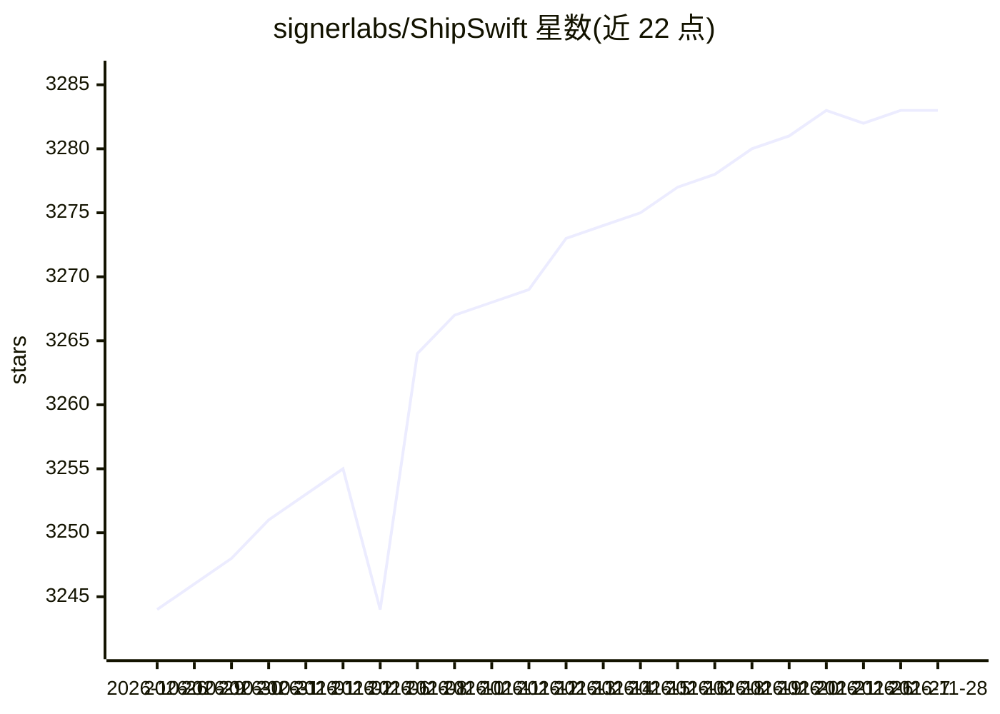

# signerlabs/ShipSwift

⭐ 3,283 · Swift · MIT · 推送 2026-11-12 · [GitHub](https://github.com/signerlabs/ShipSwift) · [官网](https://shipswift.app) · 组织维护 · 中文 README

**为 iOS 开发者提供 AI 编码代理可调用的 SwiftUI 组件库与技能包**

面向 iOS 开发的 SwiftUI 组件库，附带的 agent skills 与 MCP server 让编码代理按需获取组件源码与实现步骤。内容分四块：44 个动画组件（含 Metal shader 背景）、9 种图表、UI 组件，以及多文件模块（认证、相机、订阅付费墙、聊天等）。安装走 npm 安装技能包、连 MCP server、或直接复制文件进 Xcode 工程；另提供 Showcase App 预览全部组件。iOS 客户端代码 MIT 开源，Pro 技能（后端、合规模板等）为付费内容，仓库同时宣传定制开发服务。

## 筛选速览

| 维度 | 判定 | 备注 |
|---|---|---|
| AI 角色 | `ai-enhanced` | 去掉 AI 部分产品仍成立 |
| 许可风险 | `permissive` | MIT |
| 部署形态 | `library` | 以包/库形式分发 |
| 模型依赖 | — | README 未给出锁定关系 |
| 硬件要求 | — | 无带数字的原话,不猜 |
| 安装摩擦 | `low` | 无编译、无系统依赖或容器化 |
| 成熟度 | — | 结构信号不足 |

## 能力要点

- 44 个动画组件含 Metal shader 程序化背景与视图特效
- SWModule 提供认证、相机、StoreKit 2 付费墙、聊天等多文件框架
- MCP server 提供三个工具：listSkills、getSkill、searchSkills
- 技能包可离线安装，AI 本地读取组件源码

## 适用场景

- 用 Claude Code/Cursor 等 AI 工具快速往 iOS 工程添加动画、图表组件
- 搭建带认证、订阅付费墙的 iOS 应用原型
- 在 Xcode 中按需复制自包含的 SwiftUI 组件文件

## 场景标签

 · 领域:移动开发/组件库

## 证据(README 行号)

> L5: **AI-native SwiftUI component library — production-ready code that LLMs can use to build real apps.**
> L163: ShipSwift provides **free and Pro skills** — each skill includes complete SwiftUI source code, implementation step

## 星数曲线

2026-10-26 3,244 → 2026-11-28 3,283（+39）

---
*卡片 v1 · prompt 1.4 · 生成 2026-11-23 · 置信度 mid · 依据 README sha `8698b47139d2` · [字段定义](../../DATASET.md)*
