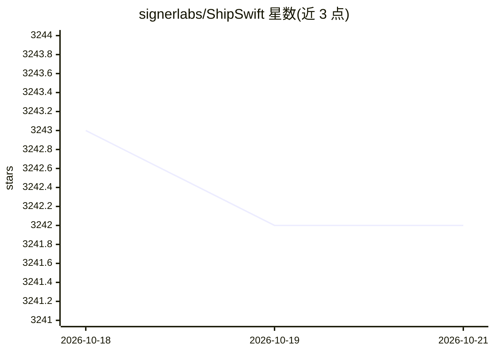

# signerlabs/ShipSwift

⭐ 3,242 · Swift · MIT · 推送 2026-10-18 · [GitHub](https://github.com/signerlabs/ShipSwift) · [官网](https://shipswift.app) · 组织维护

**供 LLM 使用的 SwiftUI 组件库与配方案例，经 MCP/Skills 接入**

面向 AI 编程助手的 SwiftUI 组件库：包含约 30 个动画组件（含 Metal 着色器背景）、8 种图表组件、UI 组件及认证/相机/付费墙/聊天等多文件模块。通过三种方式交付：npm 安装 Skills 配合 MCP 配方服务器（供 Claude Code、Gemini CLI 等检索 listRecipes/getRecipe/searchRecipes）、本地离线 Skills、或直接复制源文件到 Xcode 工程。iOS 客户端代码 MIT 开源，Pro 配方（后端、合规模板）为付费内容；另提供 $5K 起的定制 iOS 应用开发服务。

## 筛选速览

| 维度 | 判定 | 备注 |
|---|---|---|
| AI 角色 | `ai-ecosystem` | LLM/agent 周边工具 |
| 许可风险 | `permissive` | MIT |
| 部署形态 | `library` | 以包/库形式分发 |
| 模型依赖 | — | README 未给出锁定关系 |
| 硬件要求 | — | 无带数字的原话,不猜 |
| 安装摩擦 | `low` | 无编译、无系统依赖或容器化 |
| 成熟度 | — | 结构信号不足 |

## 能力要点

- 30 个动画组件（含 Metal 着色器程序化背景）+ 8 种图表 + UI 组件与多文件模块
- MCP 服务器提供 listRecipes/getRecipe/searchRecipes 三个检索工具
- 支持 Skills+MCP、本地离线 Skills、直接复制源文件三种接入方式
- SWAuth/SWPaywall/SWChat 等多文件框架模块

## 适用场景

- 让 Claude Code/Gemini CLI 等 AI 助手直接调用生产级 SwiftUI 组件构建 iOS 应用
- 离线浏览组件目录并让 AI 读取本地源码
- iOS 开发者直接复制自包含组件文件到 Xcode 工程

## 场景标签

 · 领域:iOS 开发/AI 编程基础设施

## 证据(README 行号)

> L5: **AI-native SwiftUI component library — production-ready code that LLMs can use to build real apps.**
> L19: One command gives your AI everything it needs — production-ready SwiftUI components, full-stack recipes, and the co
> L49: **Step 2** — Connect the recipe server so your AI can fetch recipes:

## 星数曲线

2026-10-18 3,243 → 2026-10-21 3,242（-1）

---
*卡片 v1 · prompt 1.4 · 生成 2026-10-20 · 置信度 high · 依据 README sha `9be90a5fb8b0` · [字段定义](../../DATASET.md)*
