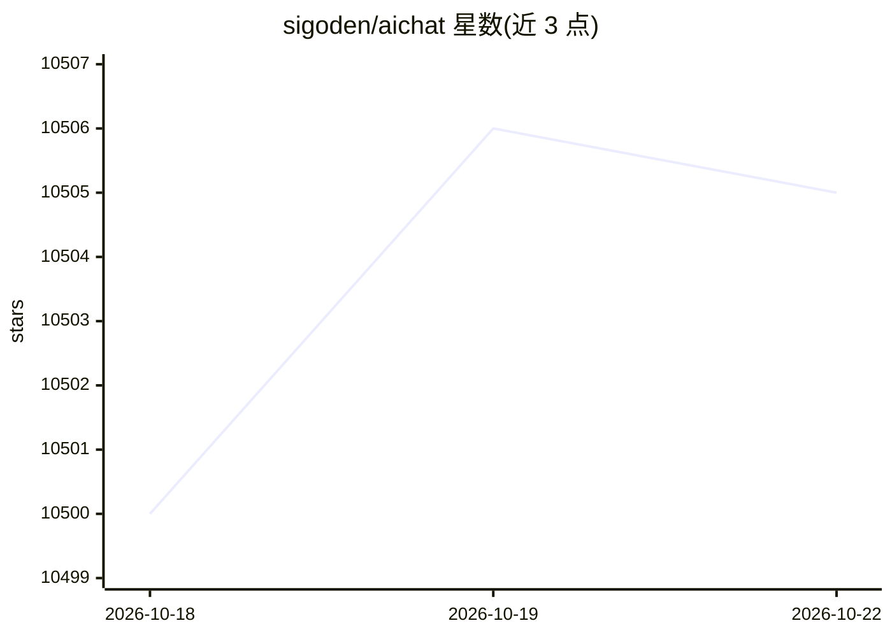

# sigoden/aichat

⭐ 10,505 · Rust · Apache-2.0 · 推送 2026-02-23 · [GitHub](https://github.com/sigoden/aichat) · 个人维护

**一体化 LLM 命令行工具：聊天、Shell 助手、RAG、工具与 Agent**

Rust 编写的命令行 LLM 客户端，通过统一接口接入 20 余家 LLM 提供商（OpenAI、Claude、Gemini、Ollama 等）。功能包括 CMD 与 REPL 交互模式、自然语言转 Shell 命令的助手、RAG 文档问答、函数调用、AI 工具（含 MCP）、AI Agent，以及内置 HTTP 服务器提供 OpenAI 兼容 API、Embeddings、Rerank、Playground 与 LLM Arena 对比页面。支持多形式输入（stdin、本地文件/目录、远程 URL）、角色、会话与宏。经 cargo、brew、pacman、scoop 等包管理器安装，并提供三大平台预编译二进制。

## 筛选速览

| 维度 | 判定 | 备注 |
|---|---|---|
| AI 角色 | `ai-ecosystem` | LLM/agent 周边工具 |
| 许可风险 | `permissive` | Apache-2.0 |
| 部署形态 | `library` | 以包/库形式分发 |
| 模型依赖 | local-ok | 支持本地模型 |
| 硬件要求 | — | 无带数字的原话,不猜 |
| 安装摩擦 | `low` | 无编译、无系统依赖或容器化 |
| 成熟度 | — | 结构信号不足 |

## 能力要点

- 统一接口接入 20 余家 LLM 提供商及任意 OpenAI 兼容 API
- 自然语言描述任务生成适配系统与 Shell 的命令
- 内置 HTTP 服务器，暴露 chat/completions、embeddings、rerank API 及 Playground/Arena
- RAG、函数调用、MCP 工具、AI Agent 与角色/会话/宏机制

## 适用场景

- 在终端中直接与多家 LLM 对话或处理文件/URL 内容
- 用自然语言生成并执行 shell 命令
- 本地部署 OpenAI 兼容代理 API 供其他应用调用
- 对比不同模型的回答质量

## 场景标签

`聊天机器人` `RAG` `AI 助手` · 领域:对话与助手

## 证据(README 行号)

> L7: AIChat is an all-in-one LLM CLI tool featuring Shell Assistant, CMD & REPL Mode, RAG, AI Tools & Agents, and More.
> L27: Integrate seamlessly with over 20 leading LLM providers through a unified interface. Supported providers include Op
> L110: AIChat includes a lightweight built-in HTTP server for easy deployment.

## 星数曲线

2026-10-18 10,500 → 2026-10-22 10,505（+5）

---
*卡片 v1 · prompt 1.4 · 生成 2026-10-20 · 置信度 high · 依据 README sha `f4f1ba401b95` · [字段定义](../../DATASET.md)*
