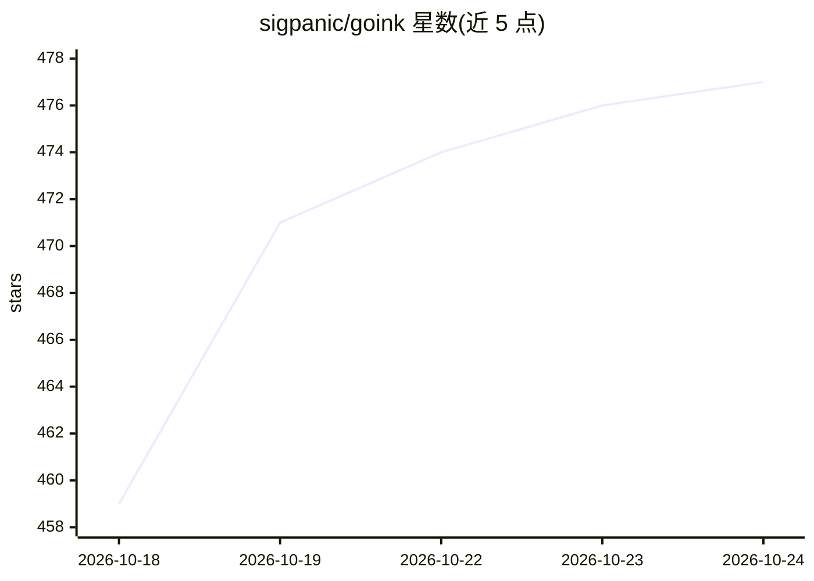

# sigpanic/goink

⭐ 477 · Go · AGPL-3.0 · 推送 2026-10-23 · [GitHub](https://github.com/sigpanic/goink) · 个人维护 · 中文 README

**桌面 AI 长篇小说创作系统：结构化记忆 + Agent 自维护**

面向长篇小说作者的桌面写作系统（Wails，Go+React）。自研 ReAct Agent 引擎（31 个 Function Calling 工具）在对话中查改角色、伏笔、弧线、地点、读者认知等结构化状态，写完自动触发维护并有独立审稿子 Agent 校验。内置本地语义搜索（bge-small-zh-v1.5 ONNX int8 量化 + sqlite-vec + MMR），无需网络。正文修改需 Diff 审批，内置 Git 历史。Skill 系统支持三层覆盖×三种模式，风格蒸馏可将样文生成为仿写 Skill。需 LLM API Key（内置 DeepSeek/GLM/MiMo 模板，兼容 OpenAI 格式）。AGPL-3.0 许可。

## 筛选速览

| 维度 | 判定 | 备注 |
|---|---|---|
| AI 角色 | `ai-native` | 本体是模型或模型工具 |
| 许可风险 | `viral` | AGPL-3.0 |
| 部署形态 | `None` |  |
| 模型依赖 | locked-api |  |
| 硬件要求 | — | 无带数字的原话,不猜 |
| 安装摩擦 | `low` | 无编译、无系统依赖或容器化 |
| 成熟度 | — | 结构信号不足 |

## 能力要点

- 角色/伏笔/弧线/地点/读者认知全链路结构化追踪，写完自动维护 + 审稿子 Agent 复核
- 本地语义搜索：BGE 中文模型 ONNX 本地推理 + sqlite-vec 向量索引 + MMR 重排序
- 31 个 Function Calling 工具的 ReAct Agent，正文修改需 Diff 审批，内置 Git 版本历史
- Skill 三层覆盖×三种触发模式，风格蒸馏从样文生成仿写 Skill

## 适用场景

- 用 AI 写长篇小说时不再丢失角色与伏笔等创作状态
- 几十万字篇幅中按语义检索前文相关段落
- 通过自定义 Skill 沉淀个人写作方法论并复用

## 场景标签

`AI 写作` `语义搜索` · 领域:内容生成

## 证据(README 行号)

> L23:  用过通用 AI 写长篇小说的人都知道——写到第五章它就忘了主角叫什么。到第三十章还要手动翻前文找那句伏笔。写完一章还得自己提醒它"更新角色状态""检查弧线进度"。Goink 不会。它是一个有结构化记忆的桌面 AI 写作系统——角
> L39: 31 个结构化工具，LLM 自主决策调用哪个、传什么参数、下一步干什么。不是"写完一章传给下一棒"的 pipeline——Agent 在当前对话中调工具查角色、查伏笔、读写正文、更新状态，直到任务完成。
> L179: 需要 LLM API Key（内置 DeepSeek、GLM、MiMo 模板，兼容 OpenAI 格式）。安装包 < 60MB，不需要 Python、Node.js、数据库或 GPU。Windows SmartScreen 可能

## 星数曲线

2026-10-18 459 → 2026-10-24 477（+18）

---
*卡片 v1 · prompt 1.4 · 生成 2026-10-21 · 置信度 high · 依据 README sha `eed96fdb6410` · [字段定义](../../DATASET.md)*
