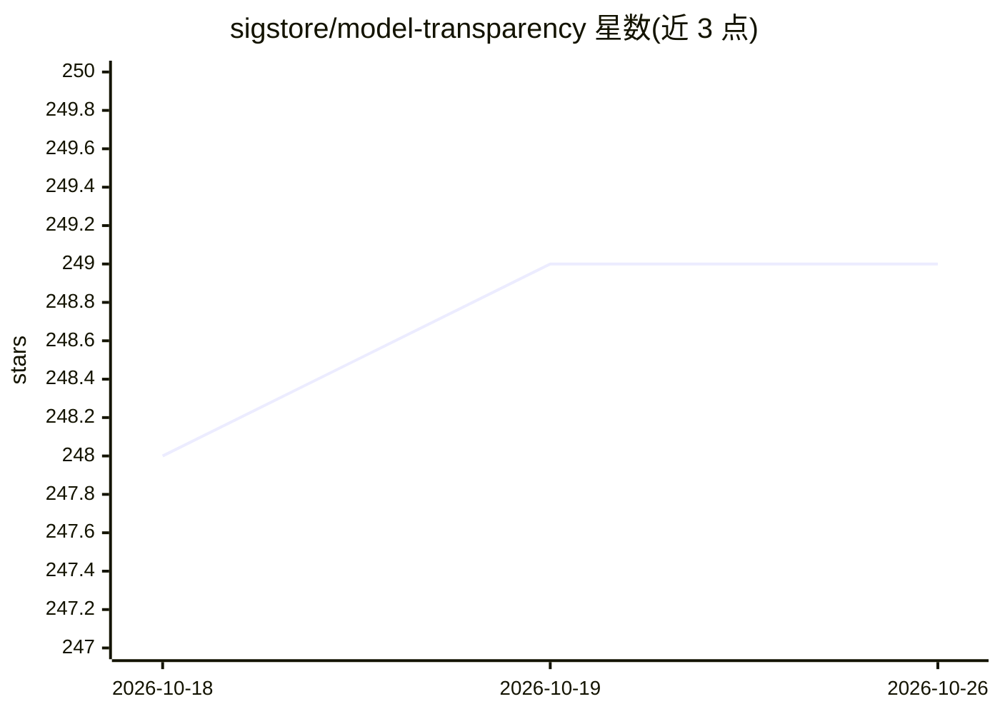

# sigstore/model-transparency

⭐ 249 · Python · Apache-2.0 · 推送 2026-10-23 · [GitHub](https://github.com/sigstore/model-transparency) · 组织维护

**给 ML 从业者的模型签名与校验工具，保障模型供应链完整性**

Sigstore 维护的 ML 供应链安全项目：对模型文件生成哈希清单，通过 Sigstore（默认）、公钥/证书或 PKCS #11 设备生成 DSSE 签名，验证时重算文件哈希与签名比对，判定模型是否在训练后被篡改。以 pip 包 model-signing 提供 CLI 与 Python API，API 分为 hashing/signing/verifying 三组件供 ML 框架、流水线与模型 Hub 集成。支持 OIDC 身份（Google/GitHub/Microsoft）、CI 工作负载身份自动签名、透明日志包含性证明，以及可选的 OpenTelemetry 追踪。

## 筛选速览

| 维度 | 判定 | 备注 |
|---|---|---|
| AI 角色 | `ai-ecosystem` | LLM/agent 周边工具 |
| 许可风险 | `permissive` | Apache-2.0 |
| 部署形态 | `self-host` | docker 或自建部署 |
| 模型依赖 | — | README 未给出锁定关系 |
| 硬件要求 | — | 无带数字的原话,不猜 |
| 安装摩擦 | `low` | 无编译、无系统依赖或容器化 |
| 成熟度 | — | 结构信号不足 |

## 能力要点

- 对模型逐文件哈希生成 manifest 并签名（Sigstore/密钥/证书/PKCS #11）
- 验证时重算哈希与已签名 manifest 比对，检测篡改
- 支持 GitHub Actions/GitLab CI/GCP/Buildkite 工作负载身份自动签名
- 提供 hashing/signing/verifying 三层 Python API 供 ML 框架与 Hub 集成

## 适用场景

- 发布模型前签名，让下载方可验证来源与完整性
- 下载模型时校验签名，确认未被篡改
- 在 CI 流水线中用工作负载身份自动签名模型

## 场景标签

`网络安全` · 领域:学习与行业

## 证据(README 行号)

> L21: This project demonstrates how to protect the integrity of a model by signing it.
> L290: We offer an API which can be used in integrations with ML frameworks, ML

## 星数曲线

2026-10-18 248 → 2026-10-26 249（+1）

---
*卡片 v1 · prompt 1.4 · 生成 2026-10-22 · 置信度 mid · 依据 README sha `374be2b85806` · [字段定义](../../DATASET.md)*
