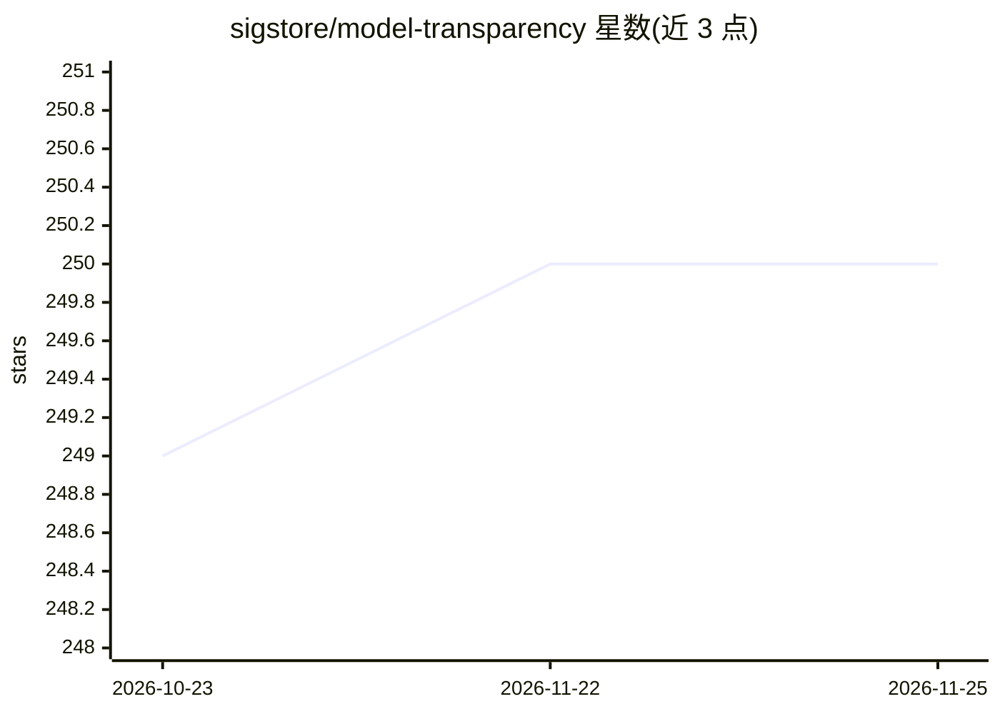

# sigstore/model-transparency

⭐ 250 · Python · Apache-2.0 · 推送 2026-11-23 · [GitHub](https://github.com/sigstore/model-transparency) · 组织维护

**为 ML 模型提供签名与验证的供应链安全库**

Sigstore 旗下的模型签名项目，为 ML 供应链提供可验证的完整性声明：对模型文件生成签名（sigstore bundle / DSSE / in-toto 格式），验证时校验签名有效性并重算文件哈希比对。支持 Sigstore OIDC 身份签名、公钥/证书签名、PKCS #11 硬件设备、RFC 3161 时间戳及私有 Sigstore 实例（自定义 Rekor/Fulcio）。提供 CLI 与 Python API（hashing/signing/verifying 三组件），可选 OpenTelemetry 观测与日志级别配置。

## 筛选速览

| 维度 | 判定 | 备注 |
|---|---|---|
| AI 角色 | `ai-ecosystem` | LLM/agent 周边工具 |
| 许可风险 | `permissive` | Apache-2.0 |
| 部署形态 | `self-host` | docker 或自建部署 |
| 模型依赖 | — | README 未给出锁定关系 |
| 硬件要求 | — | 无带数字的原话,不猜 |
| 安装摩擦 | `low` | 无编译、无系统依赖或容器化 |
| 成熟度 | — | 结构信号不足 |

## 能力要点

- CLI 支持 sign/verify/digest 子命令，默认 Sigstore 签名，兼容公钥与证书方式
- 支持 PKCS #11 硬件签名设备（RFC 7512 URI）与 RFC 3161 时间戳
- 签名事件记录至 Sigstore 透明日志，可做包含性证明与日志监控
- 提供 Python API（hashing/signing/verifying）供 ML 框架、流水线、模型库集成

## 适用场景

- 模型发布方对训练好的模型签名以证明未被篡改
- 模型下载方核验签名来源身份与文件完整性
- 通过 GitHub Actions/GitLab CI 等工作负载身份自动化签名
- 为 ML 流水线或模型托管平台集成签名验证 API

## 场景标签

`网络安全` · 领域:学习与行业

## 证据(README 行号)

> L11: Building on the work with [Open Source Security Foundation][openssf], we are
> L21: This project demonstrates how to protect the integrity of a model by signing it.
> L316: We offer an API which can be used in integrations with ML frameworks, ML

## 星数曲线

2026-10-23 249 → 2026-11-25 250（+1）

---
*卡片 v1 · prompt 1.4 · 生成 2026-11-25 · 置信度 mid · 依据 README sha `d857cea2dca3` · [字段定义](../../DATASET.md)*
