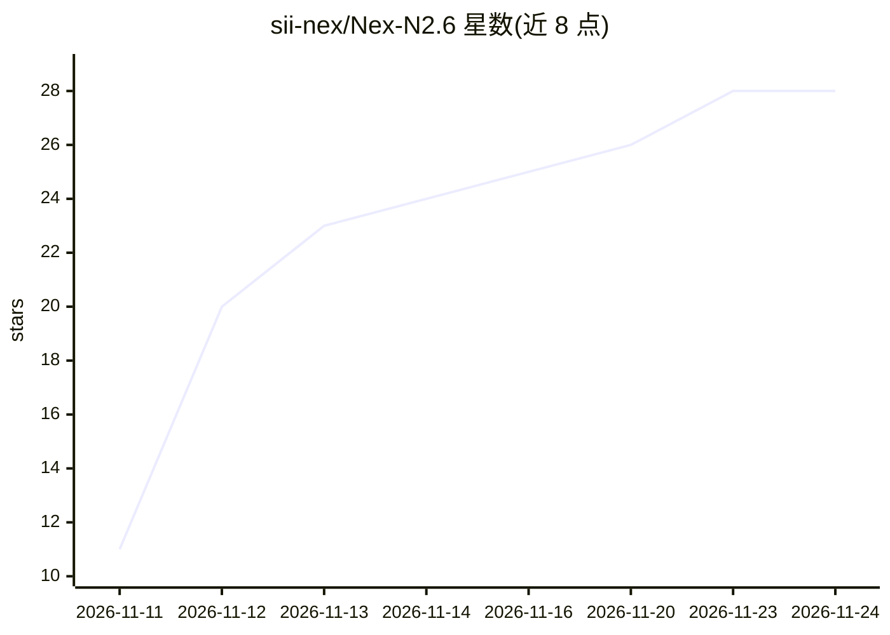

# sii-nex/Nex-N2.6

⭐ 28 · 推送 2026-11-11 · [GitHub](https://github.com/sii-nex/Nex-N2.6) · [官网](https://openrouter.ai/nex-agi/nex-n2.6) · 组织维护

**面向计算机操作与长程工作流的多模态 Agent 模型权重**

Nex-AGI 发布的多模态 agentic 模型 Nex-N2.6，基于 GLM-5.3-Flash 构建，本仓库提供约 321B 参数的 FP8 量化权重。定位为计算机操作、编程与工具型长程任务；官方数据显示其在 OSWorld、Terminal-Bench 等基准上的得分，并附内部评估的重复推理率与工具列表遵循率指标。自托管需使用支持 GLM-5.3-Flash 的推理运行时（官方给出 SGLang 部署指南），权重中捆绑 tokenizer、processor 与聊天模板，支持 reasoning_effort 分档与图像输入，工具调用由客户端/Agent 框架执行。也可通过 OpenRouter 或 MOSS 获取 API。

## 筛选速览

| 维度 | 判定 | 备注 |
|---|---|---|
| AI 角色 | `ai-native` | 本体是模型或模型工具 |
| 许可风险 | `none` | — |
| 部署形态 | `None` |  |
| 模型依赖 | locked-api |  |
| 硬件要求 | — | 无带数字的原话,不猜 |
| 安装摩擦 | `low` | 无编译、无系统依赖或容器化 |
| 成熟度 | — | 结构信号不足 |

## 能力要点

- 约 321B 参数的 FP8 量化权重，基于 GLM-5.3-Flash
- 面向计算机操作、编程与工具型长程任务
- 捆绑 tokenizer、processor 与聊天模板，支持 low/high/max reasoning_effort 分档
- OpenAI 兼容服务端口示例与图像输入内容块

## 适用场景

- 搭建能操作计算机界面完成长程任务的 Agent
- 自托管多模态模型并接入工具调用框架
- 通过 OpenRouter API 调用该模型

## 场景标签

`GUI 自动化` `多模态` · 领域:效率与自动化

## 证据(README 行号)

> L9: Nex-N2.6 is a multimodal agentic model from Nex-AGI, built on GLM-5.3-Flash. It is designed for computer use, coding
> L42: Use an inference runtime with GLM-5.3-Flash support. For self-hosting, follow the official SGLang deployment guide 

## 星数曲线

2026-11-11 11 → 2026-11-24 28（+17）

---
*卡片 v1 · prompt 1.4 · 生成 2026-11-18 · 置信度 high · 依据 README sha `ba754a209143` · [字段定义](../../DATASET.md)*
