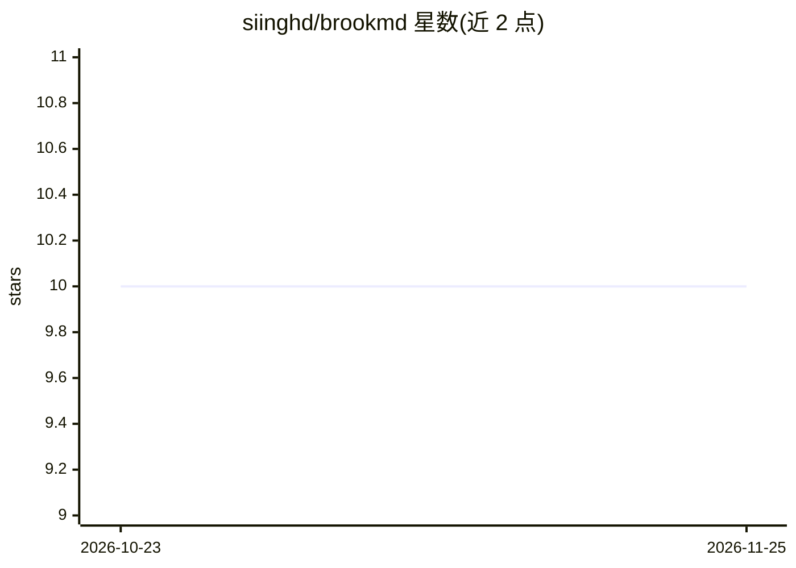

# siinghd/brookmd

⭐ 10 · Rust · MIT · 推送 2026-09-15 · [GitHub](https://github.com/siinghd/brookmd) · [官网](https://md.hsingh.app) · 个人维护

**浏览器端流式 Markdown 渲染库，面向 LLM 流式输出场景**

以 Rust 为核心的流式 Markdown 解析/渲染库，编译为 WASM 在 Web Worker 中逐块增量渲染，使多路并发 LLM 流不阻塞主线程；通过推测闭合与稳定块标识只重解析活跃尾部。声称 100% 通过 CommonMark 0.31（652/652）与 GFM（24/24）字节级一致测试。提供 React/Vue/Svelte/Solid 渲染器、Web Component 与 DOM 挂载，零运行时依赖；Swift/Kotlin/Flutter/React Native 绑定为实验状态。

## 筛选速览

| 维度 | 判定 | 备注 |
|---|---|---|
| AI 角色 | `ai-enhanced` | 去掉 AI 部分产品仍成立 |
| 许可风险 | `permissive` | MIT |
| 部署形态 | `library` | 以包/库形式分发 |
| 模型依赖 | — | README 未给出锁定关系 |
| 硬件要求 | — | 无带数字的原话,不猜 |
| 安装摩擦 | `low` | 无编译、无系统依赖或容器化 |
| 成熟度 | — | 结构信号不足 |

## 能力要点

- 解析在 Web Worker 池中进行，主线程外逐块增量渲染
- 100% CommonMark 0.31 + GFM 字节级一致（CI 强制下限）
- 多框架渲染器：React、Vue 3、Svelte 4/5、Solid、Web Component
- opt-in 的结构化 block.data 数据通道，可从数据构建目录/工具栏

## 适用场景

- 将 LLM 流式输出逐块渲染为 Markdown 而不阻塞 UI
- 在 React/Vue/Svelte/Solid 应用中流式展示聊天回复
- 同一 Rust 核心在移动端/桌面端复用渲染逻辑

## 场景标签

 · 领域:前端工具/渲染库

## 证据(README 行号)

> L14: In the browser, wire each LLM stream to a `BrookClient` and the markdown
> L143: the modern `style="text-align:…"` in place of GFM's deprecated `align="…"`.

## 星数曲线

2026-10-23 10 → 2026-11-25 10（+0）

---
*卡片 v1 · prompt 1.4 · 生成 2026-11-19 · 置信度 high · 依据 README sha `32c4474f9163` · [字段定义](../../DATASET.md)*
