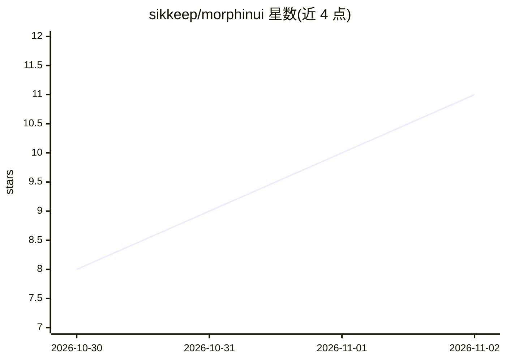

# sikkeep/morphinui

⭐ 11 · TypeScript · MIT · 推送 2026-10-29 · [GitHub](https://github.com/sikkeep/morphinui) · [官网](https://morphin.dev) · 个人维护

**面向 AI 产品的 React 组件库：CLI 复制源码进项目**

morphin-ui 是 morphin.dev 使用的 React 组件集合，基于 React 19、TypeScript、Tailwind CSS v4、Base UI 与 GSAP 构建。工作方式与 shadcn/ui 相同：不安装组件包，而是通过 npx morphinui 或 shadcn CLI 把组件源码复制到用户项目中，此后源码归用户所有可自由修改。组件覆盖按钮、下拉菜单、日历、模态框、Toast 等 20 余个，含亮/暗主题与 GSAP 动效。限制：组件需要 React 19；corner-shape 不支持的浏览器回退为普通圆角。

## 筛选速览

| 维度 | 判定 | 备注 |
|---|---|---|
| AI 角色 | `ai-enhanced` | 去掉 AI 部分产品仍成立 |
| 许可风险 | `permissive` | MIT |
| 部署形态 | `library` | 以包/库形式分发 |
| 模型依赖 | — | README 未给出锁定关系 |
| 硬件要求 | — | 无带数字的原话,不猜 |
| 安装摩擦 | `low` | 无编译、无系统依赖或容器化 |
| 成熟度 | — | 结构信号不足 |

## 能力要点

- CLI 复制组件源码进项目，源码归用户所有
- 基于 React 19、Tailwind CSS v4、Base UI 与 GSAP
- 20 余个组件，亮/暗主题内置，GSAP 内容切换动画
- 兼容 shadcn CLI 与 shadcn 令牌体系，可沿用项目现有主题

## 适用场景

- 为 AI 产品或应用搭建 React 界面的组件体系
- 在已有 shadcn 项目中按需添加 Morphin 组件
- 需要暗色模式与动效微交互的 Web 前端开发

## 场景标签

 · 领域:前端/UI 组件库

## 证据(README 行号)

> L3: React components for morphin.dev, built with **React, TypeScript, Tailwind CSS v4, Base UI and GSAP**.
> L5: morphin-ui works like shadcn/ui: you don't install a component package. The `morphinui` CLI (or the shadcn CLI) copi

## 星数曲线

2026-10-30 8 → 2026-11-02 11（+3）

---
*卡片 v1 · prompt 1.4 · 生成 2026-11-02 · 置信度 mid · 依据 README sha `b2590715a89e` · [字段定义](../../DATASET.md)*
