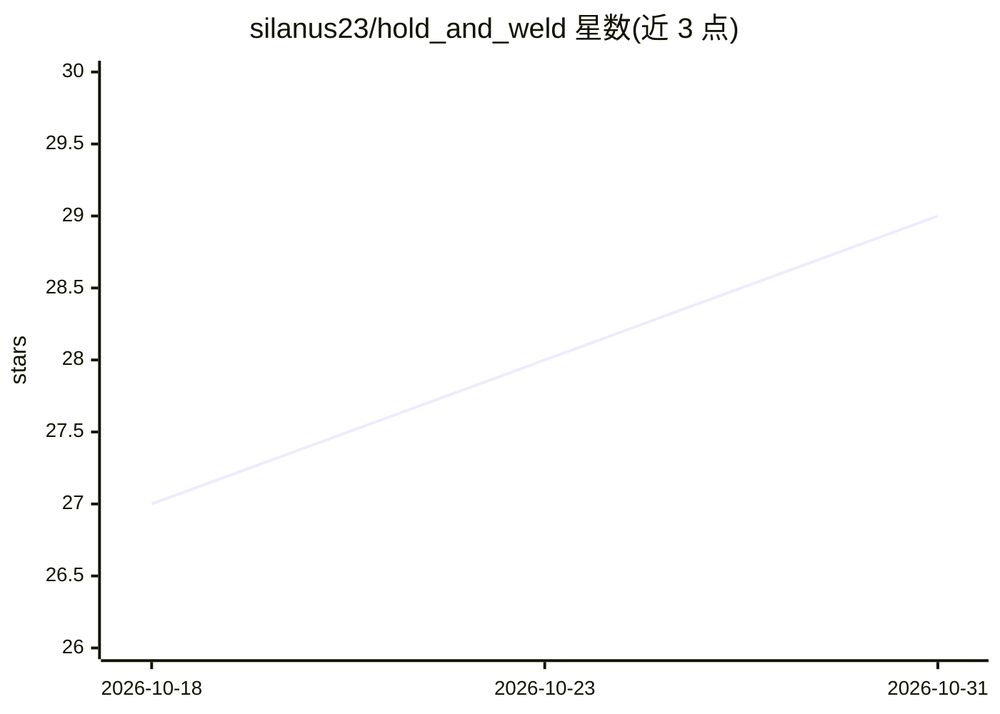

# silanus23/hold_and_weld

⭐ 29 · C++ · Apache-2.0 · 推送 2026-10-12 · [GitHub](https://github.com/silanus23/hold_and_weld) · 个人维护

**双臂机器人同时夹持与焊接的 ROS 2 框架（PoC）**

面向 ROS 2 Jazzy 的双臂工业焊接工作单元框架，含五个包：机器人描述（URDF/网格）、焊接路径生成与焊缝提取、约束感知的抓取采样（在 CAD 精确表面上采样并排除焊缝区域）、动作服务器与工作流协调（含自定义运动学求解器）、launch 启动。作者声明处于 PoC 阶段；路线图中的 AI 改进（行为树预检、抓取选择模型、抓取数据集生成）尚未实现。需 Ubuntu 24.04，依赖 MoveIt 2/Gazebo 等 rosdep 组件，OpenCASCADE 与 pythonocc-core 须从源码编译，也提供 Docker 构建路径。

## 筛选速览

| 维度 | 判定 | 备注 |
|---|---|---|
| AI 角色 | `ai-enhanced` | 去掉 AI 部分产品仍成立 |
| 许可风险 | `permissive` | Apache-2.0 |
| 部署形态 | `self-host` | docker 或自建部署 |
| 模型依赖 | — | README 未给出锁定关系 |
| 硬件要求 | — | 无带数字的原话,不猜 |
| 安装摩擦 | `low` | 无编译、无系统依赖或容器化 |
| 成熟度 | `idea` | |

## 能力要点

- 从 CAD 与网格几何提取焊缝
- 约束感知抓取采样（排除焊缝线等区域）
- 双臂协调整合为可执行工作单元（自定义运动学求解器）
- Docker 镜像内从源码构建 OpenCASCADE 与 pythonocc-core

## 适用场景

- 搭建双臂同时夹持与焊接的机器人工作单元仿真与规划
- 基于精确 CAD 表面生成避让焊缝的抓取候选
- 为自己的机器人接入该工作单元（提供 ADDING_A_ROBOT 指南）

## 场景标签

 · 领域:工业机器人/制造自动化

## 证据(README 行号)

> L3: **A ROS 2 framework for automated dual-arm robotic welding systems that perform holding and welding simultaneously w
> L22: - Weld seam extraction from CAD and mesh geometry
> L23: - Constraint-aware grasp sampling on exact CAD surfaces

## 星数曲线

2026-10-18 27 → 2026-10-31 29（+2）

---
*卡片 v1 · prompt 1.4 · 生成 2026-10-26 · 置信度 low · 依据 README sha `1e3bd3e6def0` · [字段定义](../../DATASET.md)*
