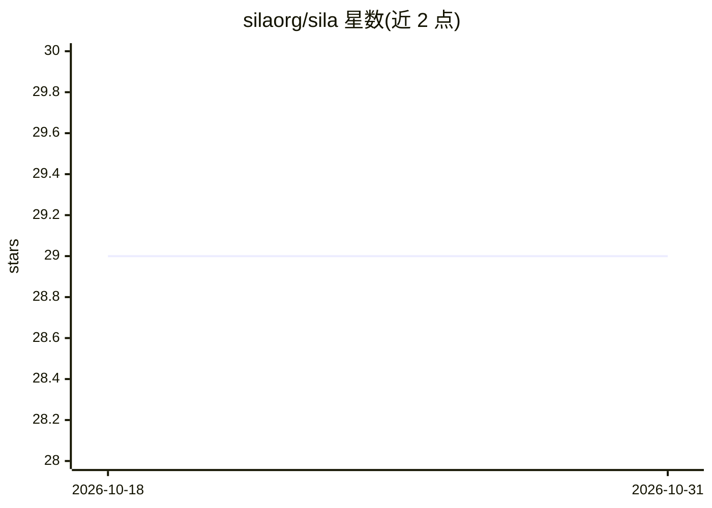

# silaorg/sila

⭐ 29 · TypeScript · MIT · 推送 2026-10-16 · [GitHub](https://github.com/silaorg/sila) · [官网](https://silain.com) · 组织维护

**本地优先的可自拥有 AI 聊天助手桌面应用**

Sila 是一款面向终端用户的 AI 聊天应用，定位为 ChatGPT 的开源替代：用户自拥有助手、对话与文件数据。数据以本地明文文件存储，可通过 iCloud/Dropbox 等同步，无需注册账号或自建服务器；后续可托管工作区并邀请成员协作。功能包括多工作区、虚拟文件系统、Markdown 文档生成与编辑、对话分支、自定义助手（指令/模型/工具）、VSCode 式分页窗口。支持接入 ChatGPT、Claude、Gemini 等主流模型，本地运行模型时可离线使用。桌面端基于 Electron，移动端基于 Capacitor，提供 macOS/Windows/Linux 安装包下载。

## 筛选速览

| 维度 | 判定 | 备注 |
|---|---|---|
| AI 角色 | `ai-native` | 本体是模型或模型工具 |
| 许可风险 | `permissive` | MIT |
| 部署形态 | `None` |  |
| 模型依赖 | — | README 未给出锁定关系 |
| 硬件要求 | — | 无带数字的原话,不猜 |
| 安装摩擦 | `low` | 无编译、无系统依赖或容器化 |
| 成熟度 | — | 结构信号不足 |

## 能力要点

- 本地优先存储：数据为本地明文文件，可经 iCloud/Dropbox 同步，无需账号
- 自定义助手：配置指令、AI 模型与工具
- 多工作区、对话分支、文件引用与 VSCode 式分页窗口
- 支持主流 AI 模型（ChatGPT 系、Claude、Gemini），本地跑模型时可离线

## 适用场景

- 不想把对话与数据托管给服务商的个人 AI 聊天
- 多设备间同步自己的 AI 助手与对话记录
- 团队后续托管工作区做协作（路线中）

## 场景标签

`AI 助手` `聊天机器人` · 领域:对话与助手

## 证据(README 行号)

> L11: Sila is like ChatGPT, but you own your assistants, chats, and files. The more you use AI, the more it learns about 
> L67: You can use any major AI model from the ones powering ChatGPT, to Claude and Gemini.
> L79: - Download for macOS

## 星数曲线

2026-10-18 29 → 2026-10-31 29（+0）

---
*卡片 v1 · prompt 1.4 · 生成 2026-10-26 · 置信度 high · 依据 README sha `a7e7d1e3c6ef` · [字段定义](../../DATASET.md)*
