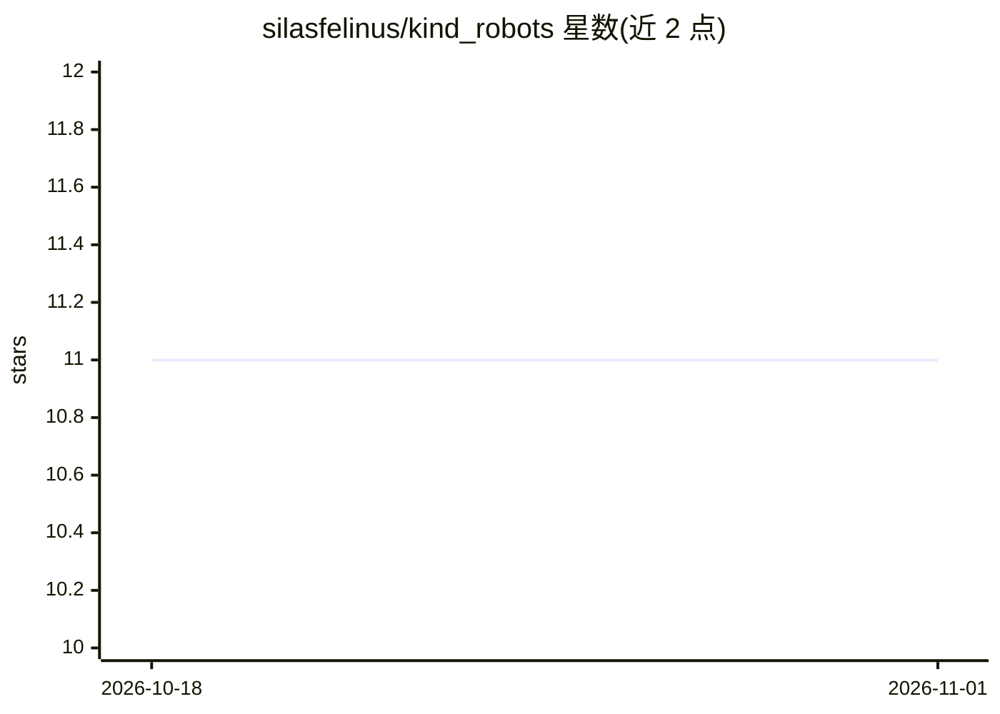

# silasfelinus/kind_robots

⭐ 11 · TypeScript · 推送 2026-10-31 · [GitHub](https://github.com/silasfelinus/kind_robots) · [官网](https://kindrobots.org) · 个人维护

**面向创意用户的 AI 世界构建平台（Dream 引擎）**

基于 Nuxt 4 / Vue 3 / Prisma + MySQL 的 Web 应用套件：以 Dream（创意种子）为核心模型，生成叙述者、角色、场景、图像等互联资产，并包含游戏、语言学习、社区、模型训练等系列子产品。AI 后端服务器无关，可选 OpenAI/Anthropic 云端 key、自托管 Stable Diffusion/ComfyUI，或使用每日补充的计量 token 默认服务。由单一开发者维护，处于活跃开发期，部分功能未上线。可直接使用 kindrobots.org 或按 README 自托管。

## 筛选速览

| 维度 | 判定 | 备注 |
|---|---|---|
| AI 角色 | `ai-native` | 本体是模型或模型工具 |
| 许可风险 | `none` | — |
| 部署形态 | `library` | 以包/库形式分发 |
| 模型依赖 | locked-api |  |
| 硬件要求 | — | 无带数字的原话,不猜 |
| 安装摩擦 | `low` | 无编译、无系统依赖或容器化 |
| 成熟度 | `idea` | |

## 能力要点

- Dream 引擎从一个种子生成交互联的叙事/角色/图像资产
- 三种 AI 后端路径：云 key / 自托管 Stable Diffusion / 默认计量 token 服务
- 多智能体构建系统 Conductor 参与项目自身开发
- 反疟疾募捐为项目核心使命

## 适用场景

- 用 AI 从一个点子构建可探索的世界设定
- 生成图像、可对话角色与分支叙事
- 自托管一个私有实例并接入自己的 AI 后端

## 场景标签

`图像生成` `AI 写作` · 领域:内容生成

## 证据(README 行号)

> L26: Everything in Kind Robots starts with a **Dream** (the central model; a Dream is sometimes referred to as a *Pitch*
> L30: - **Art** — generated imagery for your world.
> L61: Every product shares the same account, mana/token balance, and generation backends described in

## 星数曲线

2026-10-18 11 → 2026-11-01 11（+0）

---
*卡片 v1 · prompt 1.4 · 生成 2026-11-01 · 置信度 high · 依据 README sha `406551b37f94` · [字段定义](../../DATASET.md)*
