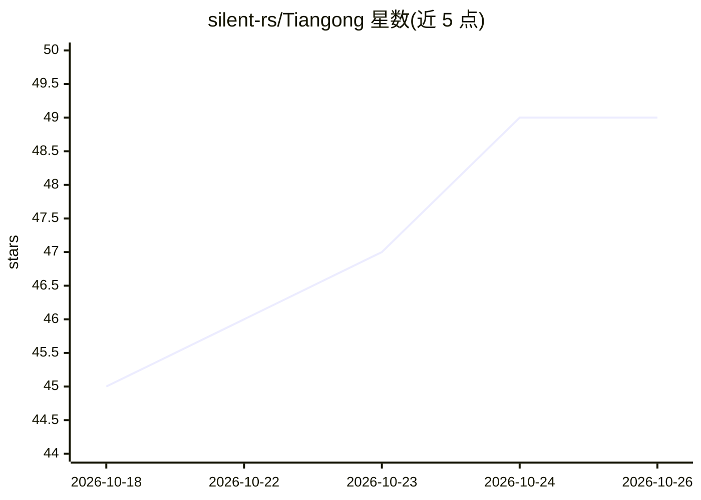

# silent-rs/Tiangong

⭐ 49 · Rust · Apache-2.0 · 推送 2026-10-25 · [GitHub](https://github.com/silent-rs/Tiangong) · 组织维护 · 中文 README

**Rust+Tauri 桌面个人 AI Agent 宿主：插件化扩展电脑操作能力**

基于 Rust、Tauri 与 silent 构建的个人智能终端，主程序仅保留 Agent 循环、模型接入、插件运行时、权限沙箱与桌面/CLI/Server 入口，文件、命令、浏览器、桌面操控、长期记忆、多智能体、定时任务等能力均由插件提供。模型接入支持 DeepSeek V4、ChatGPT 账号 OAuth、Anthropic 及 OpenAI 兼容协议。Computer Use 插件可在 macOS/Windows 操作任意桌面应用（Linux 仅控件树）。移动端通过飞书/微信/QQ Bot 或 H5 远程访问。插件支持 WASM、TypeScript、Node sidecar 等形态，可自建。

## 筛选速览

| 维度 | 判定 | 备注 |
|---|---|---|
| AI 角色 | `ai-native` | 本体是模型或模型工具 |
| 许可风险 | `permissive` | Apache-2.0 |
| 部署形态 | `desktop` | 安装包/桌面程序 |
| 模型依赖 | locked-api |  |
| 硬件要求 | — | 无带数字的原话,不猜 |
| 安装摩擦 | `medium` | 含编译或系统依赖之一 |
| 成熟度 | — | 结构信号不足 |

## 能力要点

- 插件化架构：能力以 WASM/TS/纯 UI 等形态插件提供，主程序只做运行时与沙箱边界
- Computer Use 插件可操作任意桌面应用（截图注入模型、系统级键鼠合成、无障碍控件树）
- 独立 Sandbox Launcher 跨平台沙箱（Seatbelt/bubblewrap/AppContainer）
- 飞书/微信/QQ Bot 移动端远程控制与手机 H5 远程访问

## 适用场景

- 让 Agent 替我操作微信、系统设置等原生桌面应用
- 通过手机在 IM 上远程指挥家里的 Agent 执行任务
- 和 Agent 共用同一浏览器页面完成需登录态的后台操作
- 用持久 Subagent 组织多智能体协作任务

## 场景标签

`AI 助手` `GUI 自动化` `浏览器自动化` `多智能体` · 领域:Agent 开发

## 证据(README 行号)

> L7: > 以插件为核心的个人 AI Agent 宿主：主程序负责 Agent 循环、模型接入、插件运行时与沙箱，文件、命令、浏览器、桌面操控、记忆、多智能体、定时任务等能力均由插件提供。
> L9: 天工是一个基于 Rust、Tauri 和 silent 构建的个人智能终端，以桌面应用为核心形态，同时提供 CLI 与 Server 等无界面运行方式接入脚本、服务或外部消息通道。主程序本身只保留通用骨架：会话与 ReAct 循环、
> L11: 官方插件覆盖了日常工作所需的主要能力：读写文件、执行命令和终端、操作嵌入式浏览器、唤起并操控桌面应用、长期记忆、持久 Subagent 协作、定时与触发等。插件同时可以向 Agent 声明工具、向用户贡献界面，让人与 Agent 

## 星数曲线

2026-10-18 45 → 2026-10-26 49（+4）

---
*卡片 v1 · prompt 1.4 · 生成 2026-10-25 · 置信度 mid · 依据 README sha `cda0c8010a6d` · [字段定义](../../DATASET.md)*
