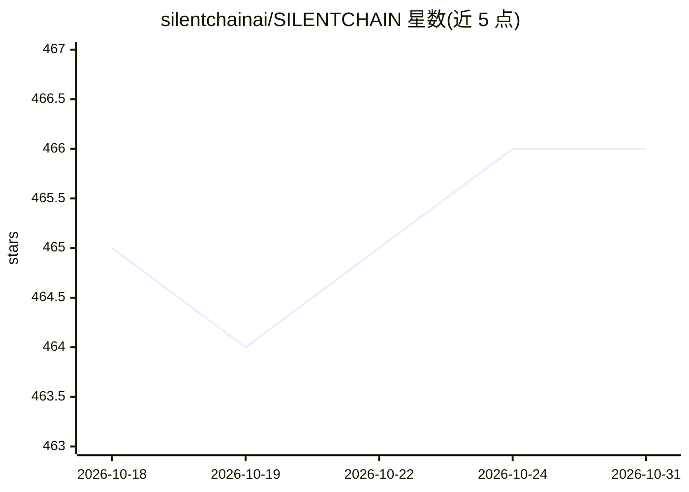

# silentchainai/SILENTCHAIN

⭐ 466 · Java · NOASSERTION · 推送 2026-10-03 · [GitHub](https://github.com/silentchainai/SILENTCHAIN) · [官网](https://silentchain.ai) · 组织维护

**Burp Suite 扩展：用 AI 被动分析流量检测 Web 漏洞**

面向 Web 安全测试人员的 Burp Suite Professional Java 扩展，以被动扫描方式分析经过 Burp 代理的 HTTP 流量，检测 OWASP Top 10 类漏洞（注入、XSS、访问控制等），输出 CWE/OWASP 映射与修复建议的发现。支持 Burp AI（默认）、Ollama、OpenAI、Claude、Gemini、Azure OpenAI/Foundry 六种 AI 提供方；发送前通过 DataSanitizer 脱敏凭据、密钥与 PII 并中和提示注入。要求 Burp Suite Professional 2025.8+ 与 Java 21，Community Edition 不受支持。

## 筛选速览

| 维度 | 判定 | 备注 |
|---|---|---|
| AI 角色 | `ai-enhanced` | 去掉 AI 部分产品仍成立 |
| 许可风险 | `none` | NOASSERTION |
| 部署形态 | `desktop` | 安装包/桌面程序 |
| 模型依赖 | local-ok | 支持本地模型 |
| 硬件要求 | — | 无带数字的原话,不猜 |
| 安装摩擦 | `medium` | 含编译或系统依赖之一 |
| 成熟度 | — | 结构信号不足 |

## 能力要点

- 被动分析 Burp 代理流量，检测 OWASP Top 10 漏洞并映射 CWE
- 六种 AI 提供方：Burp AI（默认零配置）/Ollama/OpenAI/Claude/Gemini/Azure
- DataSanitizer 发送前脱敏凭据、API 密钥、PII 并中和提示注入
- 支持右键单请求按需分析与原生 Burp issue 输出

## 适用场景

- 渗透测试时对代理流量做 AI 辅助的被动漏洞检测
- bug bounty 中自动分析范围内请求的注入与 XSS 等问题
- 本地 Ollama 隐私模式下做安全分析

## 场景标签

`网络安全` · 领域:学习与行业

## 证据(README 行号)

> L27: **SILENTCHAIN AI™ - Community Edition** is a Burp Suite extension that brings the power of artificial intelligence 
> L33: - **🧠 AI-Powered Analysis**: Leverages state-of-the-art language models (Burp AI, Ollama, OpenAI, Claude, Gemini, A

## 星数曲线

2026-10-18 465 → 2026-10-31 466（+1）

---
*卡片 v1 · prompt 1.4 · 生成 2026-10-21 · 置信度 high · 依据 README sha `26d02fdb0904` · [字段定义](../../DATASET.md)*
