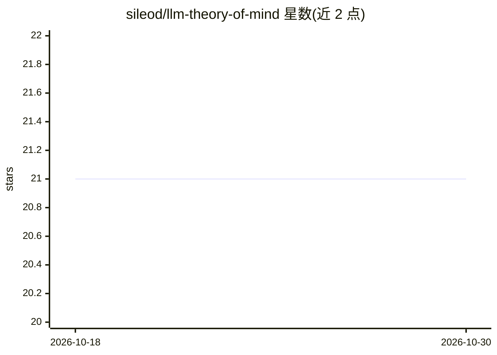

# sileod/llm-theory-of-mind

⭐ 21 · Python · Apache-2.0 · 推送 2026-10-13 · [GitHub](https://github.com/sileod/llm-theory-of-mind) · 个人维护

**用认知逻辑生成问题、评测语言模型心智理论的基准**

MindGames 论文（EMNLP Findings 2023）的配套代码与数据集：基于动态认知模态逻辑自动生成类似 muddy children 的认知推理问题，用于测试自然语言模型的心智理论（ToM）能力。问题标签由 SMCDEL 求得，另有独立编写的第二检查器交叉验证标签；评测脚本通过 OpenRouter 调用任意模型作答并打分，截断或不可解析的回答计为错误。数据集托管在 HuggingFace（v1.3）。

## 筛选速览

| 维度 | 判定 | 备注 |
|---|---|---|
| AI 角色 | `ai-knowledge` | 知识聚合/清单类 |
| 许可风险 | `permissive` | Apache-2.0 |
| 部署形态 | `library` | 以包/库形式分发 |
| 模型依赖 | locked-api |  |
| 硬件要求 | — | 无带数字的原话,不猜 |
| 安装摩擦 | `low` | 无编译、无系统依赖或容器化 |
| 成熟度 | — | 结构信号不足 |

## 能力要点

- 基于模态逻辑自动生成认知推理问题
- SMCDEL 标注 + 独立第二检查器交叉验证
- 经 OpenRouter 评测任意模型并输出分数
- 提供 multi-round muddy-children 的 diamond 测试配置

## 适用场景

- 我要评测 LLM 在心智理论/认知推理任务上的表现
- 我要研究模态逻辑生成的推理基准数据
- 复现论文中的实验结果

## 场景标签

`模型评测` · 领域:评测与运维

## 证据(README 行号)

> L4: We generate epistemic reasoning problems (akin to muddy children or drinking logicians) using modal logic to target 
> L6: 🤗 https://hf.co/datasets/sileod/mindgames (version 1.3, see the changelog there)

## 星数曲线

2026-10-18 21 → 2026-10-30 21（+0）

---
*卡片 v1 · prompt 1.4 · 生成 2026-10-28 · 置信度 mid · 依据 README sha `2fc7f0938283` · [字段定义](../../DATASET.md)*
