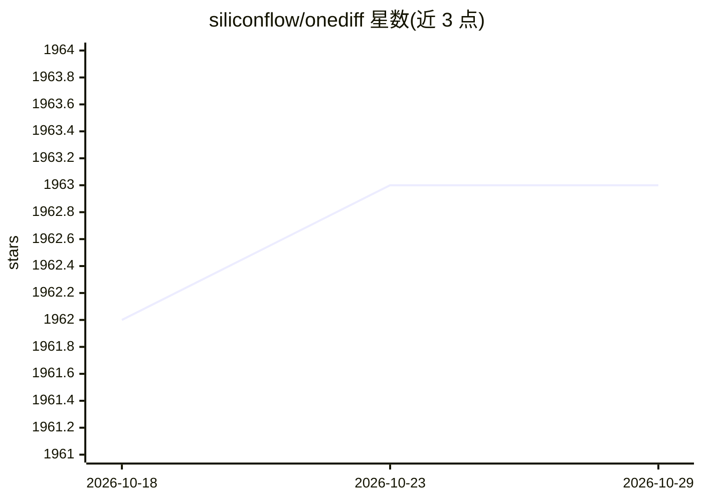

# siliconflow/onediff

⭐ 1,963 · Jupyter Notebook · Apache-2.0 · 推送 2025-12-04 · [GitHub](https://github.com/siliconflow/onediff) · [官网](https://github.com/siliconflow/onediff/wiki) · 组织维护 · 中文 README

**扩散模型推理加速库：一行代码加速 SD/SDXL/SVD 等生成**

面向 AIGC 服务场景的扩散模型加速库，为 HF diffusers、ComfyUI、Stable Diffusion web UI 提供即插即用的加速：通过 PyTorch 图编译工具与优化的 GPU Kernel 缩短生成耗时，支持 LoRA 毫秒级切换、ControlNet、离线编译保存后在其他设备加载以做在线服务与多进程部署。需 NVIDIA GPU（Linux，Windows 需 WSL），安装时须二选一配置 OneFlow 或 Nexfort 编译后端；另提供含更多优化的企业版方案。

## 筛选速览

| 维度 | 判定 | 备注 |
|---|---|---|
| AI 角色 | `ai-ecosystem` | LLM/agent 周边工具 |
| 许可风险 | `permissive` | Apache-2.0 |
| 部署形态 | `library` | 以包/库形式分发 |
| 模型依赖 | — | README 未给出锁定关系 |
| 硬件要求 | — | 无带数字的原话,不猜 |
| 安装摩擦 | `medium` | 含编译或系统依赖之一 |
| 成熟度 | — | 结构信号不足 |

## 能力要点

- 对 diffusers / ComfyUI / SD web UI 即插即用加速，SDXL 编译约 1 分钟
- 支持离线编译保存、跨设备加载与多进程在线服务
- LoRA 切换耗时百毫秒级，占用数十至数百 MB
- 支持 SD1.5~2.1、SDXL (Turbo/Lightning/DeepCache)、SVD、InstantID 等

## 适用场景

- 加速 ComfyUI 或 diffusers 的 SD/SDXL 出图流程
- 在线 AIGC 服务中离线编译、在线加载以减少冷启动
- 生产环境多 GPU 分布式推理加速（配合 xDiT 等）

## 场景标签

`推理引擎` · 领域:训练与推理

## 证据(README 行号)

> L3: **onediff** is an out-of-the-box acceleration library for diffusion models, it provides:
> L4: - Out-of-the-box **acceleration** for popular UIs/libs(such as **HF diffusers** and **ComfyUI**)
> L5: - PyTorch code **compilation tools** and strong optimized **GPU Kernels** for diffusion models

## 星数曲线

2026-10-18 1,962 → 2026-10-29 1,963（+1）

---
*卡片 v1 · prompt 1.4 · 生成 2026-10-21 · 置信度 high · 依据 README sha `b9d57659cabc` · [字段定义](../../DATASET.md)*
