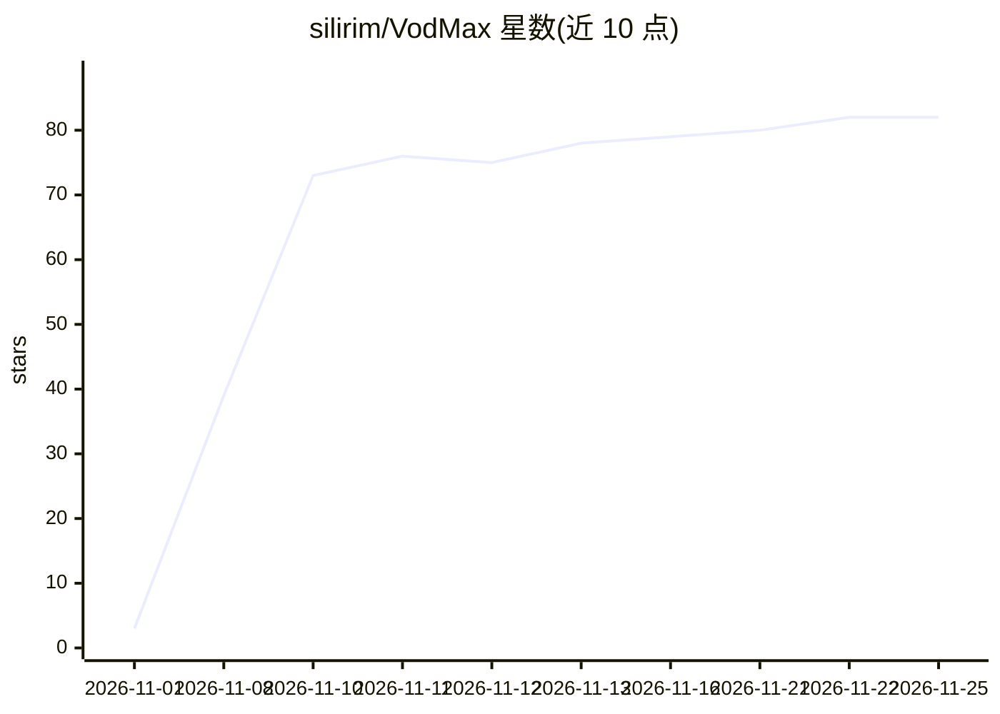

# silirim/VodMax

⭐ 82 · Go · AGPL-3.0 · 推送 2026-11-16 · [GitHub](https://github.com/silirim/VodMax) · [官网](https://vodmax.silirim.com) · 个人维护

**自托管媒体中心：IPTV 直播、EPG、DVR 与影视剧集管理**

用 Go 编写的自托管家庭媒体中心，服务器端以 SQLite 存储大规模目录，聚合 M3U/Xtream Codes 播放列表与本地影视文件夹，提供频道换台、XMLTV 节目单、时移、按规则录像的 DVR、海报元数据（可接 TMDB）、多用户档案与 WireGuard 内置 VPN。客户端覆盖浏览器、Android/Android TV/Fire TV、LG webOS（三星 beta）。内置可选 AI 助手，可用本地下载模型、在线服务 API key 或自有服务器，用于自然语言生成录像规则与观看推荐。不提供任何内容，仅管理用户自有的合法来源。

## 筛选速览

| 维度 | 判定 | 备注 |
|---|---|---|
| AI 角色 | `ai-enhanced` | 去掉 AI 部分产品仍成立 |
| 许可风险 | `viral` | AGPL-3.0 |
| 部署形态 | `self-host` | docker 或自建部署 |
| 模型依赖 | — | README 未给出锁定关系 |
| 硬件要求 | — | 无带数字的原话,不猜 |
| 安装摩擦 | `low` | 无编译、无系统依赖或容器化 |
| 成熟度 | `idea` | |

## 能力要点

- 单 SQLite 数据库支持数十万条目的目录与全文搜索
- 直播优先设计：频道号、多视图（2/4 频道）、时移与按规则 DVR
- 可选 AI 助手：内置本地模型/在线服务/自有服务器三种方式生成录像规则
- 面向 Plex/Jellyfin/Emby 呈现为 HDHomeRun 调谐器，并向 TiviMate/Kodi/VLC 提供 M3U 与 XMLTV

## 适用场景

- 把多个 IPTV 播放列表与本地影视库聚合到一个家庭服务器
- 像机顶盒一样在电视上换台、暂停、回看和按规则录像
- 通过 VPN 限制播放列表流量保护隐私
- 用一句话让助手安排一次录像或询问今晚看什么

## 场景标签

`AI 助手` · 领域:对话与助手

## 证据(README 行号)

> L3: **Your live TV, your movies and your series in one self-hosted media center.**
> L54: |✨ **Assistant**|Optional: built in (VodMax downloads and runs the model at home), Claude and other online services

## 星数曲线

2026-11-01 3 → 2026-11-25 82（+79）

---
*卡片 v1 · prompt 1.4 · 生成 2026-11-18 · 置信度 high · 依据 README sha `0ba224ecfbc8` · [字段定义](../../DATASET.md)*
