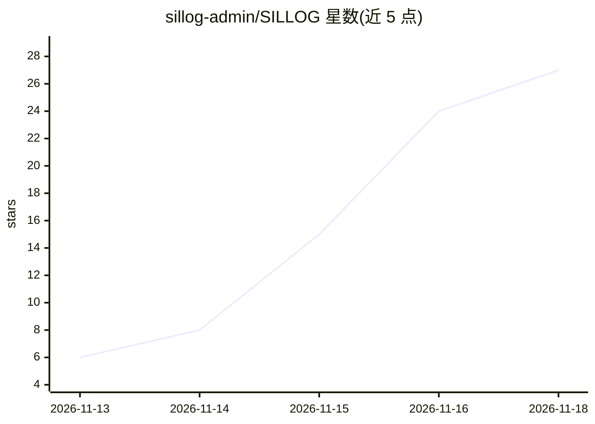

# sillog-admin/SILLOG

⭐ 27 · Swift · AGPL-3.0 · 推送 2026-11-17 · [GitHub](https://github.com/sillog-admin/SILLOG) · [官网](https://sillog.app) · 组织维护 · 中文 README

**macOS 个人工作记录应用：自动记录活动并用 AI 整理成业务图谱**

面向个人用户的 macOS 本地优先 lifelog 应用：自动记录使用的应用、窗口、网页、屏幕文字、文件、发送给 AI 编码工具的请求与录音，全部存入本机 SQLite；LLM 每 5 分钟将记录按业务单元聚类并组织为知识图谱（2D/3D 网络、环形图、桑基图）。聊天中基于记录生成报告、调查结果与计划，每个回答附带所引用记录的出处。需 macOS 14+ Apple Silicon，并连接 ChatGPT 订阅或 OpenAI 兼容 API（含本地模型）；未连接 AI 时不记录任何内容。开发者自述为初期原型。

## 筛选速览

| 维度 | 判定 | 备注 |
|---|---|---|
| AI 角色 | `ai-native` | 本体是模型或模型工具 |
| 许可风险 | `viral` | AGPL-3.0 |
| 部署形态 | `desktop` | 安装包/桌面程序 |
| 模型依赖 | — | README 未给出锁定关系 |
| 硬件要求 | — | 无带数字的原话,不猜 |
| 安装摩擦 | `low` | 无编译、无系统依赖或容器化 |
| 成熟度 | `idea` | |

## 能力要点

- 自动记录应用/网页/文件/AI 工具请求并每 5 分钟按业务聚类为图谱
- 聊天基于记录生成报告，回答附带记录出处
- 记录全部存本机 SQLite，无自建服务器，传输可按功能关闭
- 通过 MCP 向 ChatGPT/Claude 桌面应用提供只读记录检索

## 适用场景

- 自动整理每天的工作记录并按业务分类
- 基于历史记录生成周报、调研与计划
- 回到某项业务时重开当时的文件、网页与应用

## 场景标签

`知识图谱` `文档问答` · 领域:知识与检索

## 证据(README 行号)

> L13: SILLOG(실록)은 Mac에서 쓰는 앱과 창, 웹페이지, 화면 글자, 파일, AI 코딩 도구에 보낸 요청, 녹음을 기록합니다. 기록은 LLM이 업무 단위로 묶어 그래프로 정리하고, 채팅에서는 이 기록을 근
> L86: 내 Mac 안에서 수집, SQLite 저장, 5분마다 정리, 업무 그래프, 채팅과 결과물로 이어지고, 기록 요약과 질문만 ChatGPT(또는 설정한 API)로, 허용한 경우에만 웹 검색과 커넥터로 나갑니다.
> L95: - ChatGPT 구독이나 OpenAI 호환 API 키. AI를 연결하기 전에는 아무것도 기록하지 않습니다.

## 星数曲线

2026-11-13 6 → 2026-11-18 27（+21）

---
*卡片 v1 · prompt 1.4 · 生成 2026-11-18 · 置信度 high · 依据 README sha `7f6fe2122ecb` · [字段定义](../../DATASET.md)*
