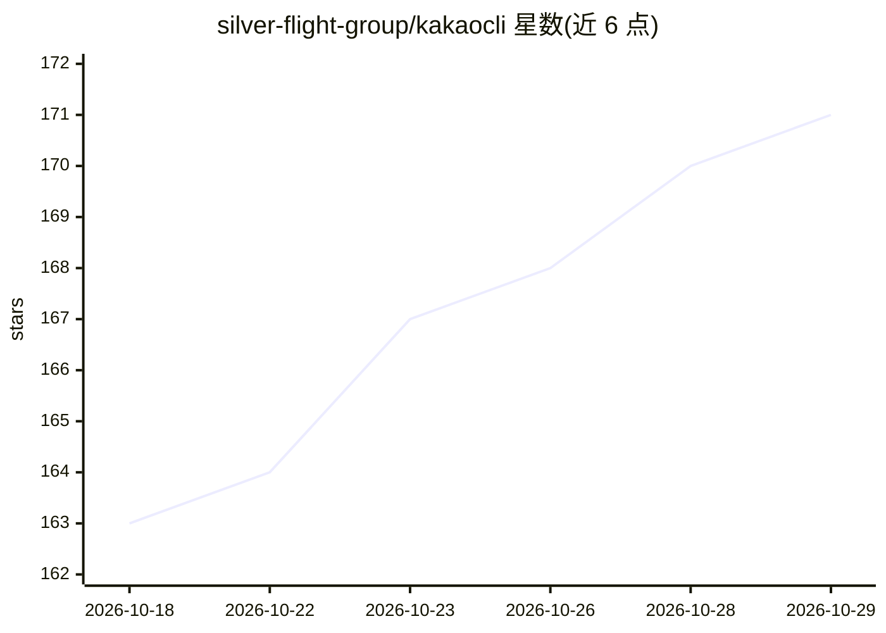

# silver-flight-group/kakaocli

⭐ 171 · Swift · MIT · 推送 2026-03-30 · [GitHub](https://github.com/silver-flight-group/kakaocli) · 组织维护

**macOS KakaoTalk CLI：让 AI agent 读写本地消息**

面向 macOS 的 KakaoTalk 命令行工具，供 AI agent（Claude Code、Cursor、自定义 bot）读取与发送消息。机制：只读方式解密 KakaoTalk 本地 SQLCipher 数据库实现聊天列表、消息查看、全文检索与只读 SQL 查询；发送与界面交互通过 macOS Accessibility API 自动化原生客户端。提供 JSON 输出、MCP/skill 定义、NDJSON 实时流与 webhook、自动登录。限制：仅 macOS、仅文本消息、需 Full Disk Access/Accessibility 权限、每账号仅一台 Mac 登录。

## 筛选速览

| 维度 | 判定 | 备注 |
|---|---|---|
| AI 角色 | `ai-ecosystem` | LLM/agent 周边工具 |
| 许可风险 | `permissive` | MIT |
| 部署形态 | `None` |  |
| 模型依赖 | locked-api |  |
| 硬件要求 | — | 无带数字的原话,不猜 |
| 安装摩擦 | `low` | 无编译、无系统依赖或容器化 |
| 成熟度 | — | 结构信号不足 |

## 能力要点

- 只读解密本地 SQLCipher 数据库，读取/检索/SQL 查询消息
- macOS Accessibility API 自动化发送、harvest、自动登录
- NDJSON 实时流、webhook、全命令 JSON 输出
- 内置 Claude Code / OpenClaw skill 定义

## 适用场景

- 让 Claude Code 等 agent 代读、检索并代发 KakaoTalk 消息
- 通过 webhook 对收到的消息做实时自动回复
- 批量采集聊天记录供整理或总结

## 场景标签

`GUI 自动化` `聊天机器人` · 领域:效率与自动化

## 证据(README 行号)

> L16: kakaocli lets AI agents (Claude Code, Cursor, custom bots) check and send your KakaoTalk messages — something Kakao
> L18: - **AI Agent Integration** — JSON output for every command, MCP skill definition, webhook delivery, auto-login
> L164: ## AI Integration / AI 연동

## 星数曲线

2026-10-18 163 → 2026-10-29 171（+8）

---
*卡片 v1 · prompt 1.4 · 生成 2026-10-22 · 置信度 high · 依据 README sha `77767d9e4b47` · [字段定义](../../DATASET.md)*
