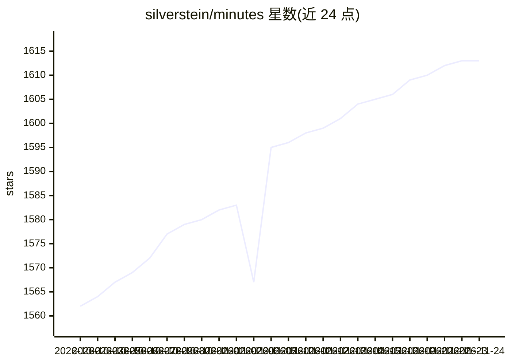

# silverstein/minutes

⭐ 1,616 · Rust · MIT · 推送 2026-11-23 · [GitHub](https://github.com/silverstein/minutes) · [官网](https://useminutes.app) · 个人维护

**本地优先的会议录音转录工具，供 MCP 客户端查询**

本地运行的对话记录应用：在设备上录制并转录会议、通话、语音备忘录，输出用户自有的 Markdown 文件（~/meetings/，含 YAML frontmatter）。通过 MCP 服务器（34 个工具）供 Claude Code、Codex、Cursor 等 MCP 客户端搜索历史；提供桌面应用、60 命令的 CLI、Claude Code 插件（23 个技能）与 TypeScript SDK。转录与说话人处理在本地执行，仅当用户授权时才向云端助手发送上下文。

## 筛选速览

| 维度 | 判定 | 备注 |
|---|---|---|
| AI 角色 | `ai-native` | 本体是模型或模型工具 |
| 许可风险 | `permissive` | MIT |
| 部署形态 | `library` | 以包/库形式分发 |
| 模型依赖 | local-ok | 支持本地模型 |
| 硬件要求 | — | 无带数字的原话,不猜 |
| 安装摩擦 | `low` | 无编译、无系统依赖或容器化 |
| 成熟度 | — | 结构信号不足 |

## 能力要点

- 在设备上完成会议、通话与语音备忘录的转录，输出自有 Markdown 文件
- MCP 服务器提供 34 个工具，供任意 MCP 客户端搜索会议历史
- 桌面应用、60 命令 CLI、Claude Code 插件（23 个技能）与 TypeScript SDK 四种形态
- 敏感会议默认受限保存，含同意提醒与来源记录机制

## 适用场景

- 会议录音后在 Claude Code/Cursor 等客户端中以对话方式检索内容
- 将会议记录作为本地第二大脑的采集层，导入 Obsidian 等知识库
- 在本地完成语音听写并保持音频不出设备

## 场景标签

`语音识别` `知识库管理` · 领域:知识与检索

## 证据(README 行号)

> L10: Minutes is a free, open-source conversation memory app for the AI you already use. Record and transcribe meetings, 
> L12: Capture, transcription, and storage run locally. If you choose a cloud AI assistant or summarizer, the meeting cont
> L134: - Transcription and speaker processing run on-device. Audio stays on your machine.

## 星数曲线

2026-10-22 1,562 → 2026-11-24 1,613（+51）

---
*卡片 v1 · prompt 1.4 · 生成 2026-11-23 · 置信度 high · 依据 README sha `518187390024` · [字段定义](../../DATASET.md)*
